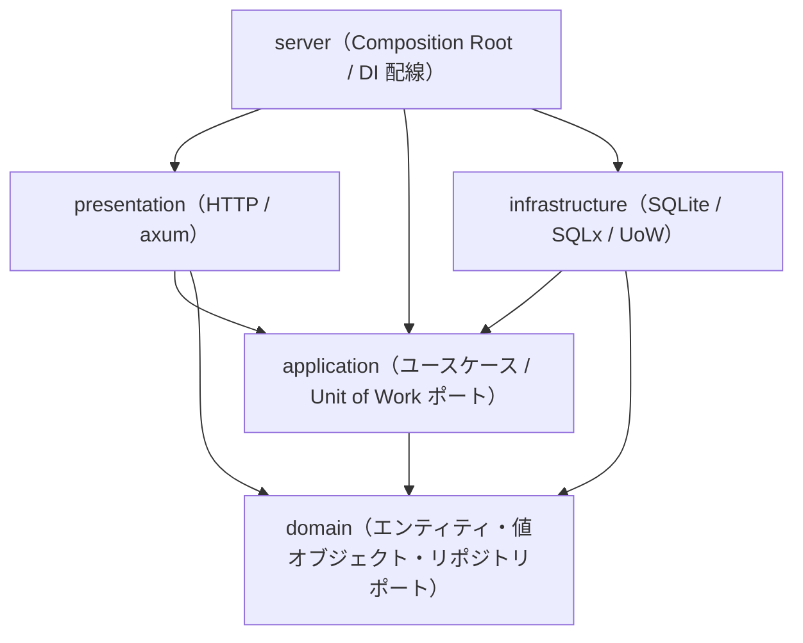

# dddrs

[](https://github.com/iktakahiro/dddrs/actions/workflows/ci.yml)

[English](README.md) | 日本語

[axum](https://github.com/tokio-rs/axum) と [SQLx](https://github.com/launchbadge/sqlx)（SQLite）を用いた、**Rust によるドメイン駆動設計（DDD）およびオニオンアーキテクチャ**の実装サンプル兼・各レイヤー設計ガイドです。

姉妹リポジトリ:
- Python 版: [dddpy](https://github.com/iktakahiro/dddpy)
- Go 版: [oniongo](https://github.com/iktakahiro/oniongo)

この Rust 版の主な特徴:
- **型で守る状態:** `TodoState` ADT と検証済み newtype で不正な状態を表現不可能にします（[Domain 層](#1-domain-層cratesdomain)）。
- **クレート境界 + CI で守る層:** 層ごとに Cargo クレートを分け、許可する依存方向は CI の `cargo metadata` テストで検査します（[クレート境界と CI による依存チェック](#クレート境界と-ci-による依存チェック)）。
- **Python（`dddpy`）との比較:** 同じ Todo API を題材に言語・設計の違いを整理しています（[`dddpy` との設計比較](#dddpy-との設計比較)）。

> **注意:** このリポジトリはアーキテクチャ設計のベースとなるリファレンスサンプルです。認証・認可・レート制限・本番向けロギング等は意図的に省いています。実サービスへ応用する際は、これらを適切に実装してください。

## 技術スタック

- **言語:** Rust（Edition 2024 / Rust 1.85 以上）
- **Web フレームワーク:** [axum](https://github.com/tokio-rs/axum) 0.8 + [Tokio](https://tokio.rs/)
- **データベース:** [SQLx](https://github.com/launchbadge/sqlx) 0.8 + SQLite（同梱ビルド・マイグレーション付き）
- **エラーハンドリング:** [thiserror](https://github.com/dtolnay/thiserror)
- **日時・ID:** [chrono](https://github.com/chronotope/chrono), [uuid](https://github.com/uuid-rs/uuid)
- **E2E テスト（任意）:** [Hurl](https://hurl.dev/)

## クイックスタート

### 前提条件

- **Rust 1.85 以上**（Edition 2024 に必要です。[rustup](https://rustup.rs/) で導入できます）
- **C コンパイラ**（`libsqlite3-sys` が SQLite を同梱ビルドするために必要です。外部の SQLite サーバーや `sqlx-cli` のインストールは不要です）
- `curl`、`jq`（以下の動作確認コマンド用・任意）

### サーバーの起動

```sh
cargo run --locked -p server
```

起動するとカレントディレクトリに `todos.db` が作成され、SQL マイグレーションが自動で適用されます。

| 環境変数 | デフォルト値 | 説明 |
| --- | --- | --- |
| `DATABASE_URL` | `sqlite://todos.db` | SQLite の接続 URL |
| `BIND_ADDR` | `127.0.0.1:3000` | 待受アドレスとポート |

### API の動作確認

このサンプルの核となるドメインルールは **「未開始の Todo は完了できない」** という状態遷移ルールです。

```sh
BASE_URL=http://127.0.0.1:3000

# 1. Todo を作成する
TODO_ID=$(curl -fsS -X POST "$BASE_URL/todos" \
  -H 'Content-Type: application/json' \
  -d '{"title":"夕飯の買い物","description":"野菜を買う"}' \
  | jq -r .id)

# 2. 未開始のまま完了しようとすると 400 Bad Request になる
curl -sS -i -X PATCH "$BASE_URL/todos/$TODO_ID/complete"

# 3. 開始 → 完了
curl -fsS -X PATCH "$BASE_URL/todos/$TODO_ID/start" | jq
curl -fsS -X PATCH "$BASE_URL/todos/$TODO_ID/complete" | jq

# 4. 取得・削除
curl -fsS "$BASE_URL/todos/$TODO_ID" | jq
curl -fsS -i -X DELETE "$BASE_URL/todos/$TODO_ID"
```

レスポンス例（`201 Created`）:

```json
{
  "id": "550e8400-e29b-41d4-a716-446655440000",
  "title": "夕飯の買い物",
  "description": "野菜を買う",
  "status": "not_started",
  "created_at": 1735689600000,
  "updated_at": 1735689600000,
  "completed_at": null
}
```

## アーキテクチャ概要

Cargo ワークスペースで**オニオンアーキテクチャの各層を独立したクレートに分けて境界を切り**（未宣言クレートの参照や循環依存はコンパイル時に防止）、許可する依存方向は CI で検査しています。



### ワークスペース構成

```text
crates/
├── domain/                       # 純粋なビジネスルール（axum / sqlx / serde 非依存）
│   └── src/
│       ├── error.rs              # エンティティ横断の RepositoryError
│       └── todo/
│           ├── entity.rs         # Todo 集約、TodoState ADT、TransitionError
│           ├── values.rs         # TodoId、Title、Description、ValidationError
│           └── repository.rs     # TodoRepository trait と Snapshot
├── application/                  # 単一責任のユースケース & トランザクションポート
│   └── src/
│       ├── uow.rs                # UnitOfWork / UnitOfWorkFactory trait
│       └── todo/                 # 1 ユースケース = 1 Struct・1 execute() メソッド
│           ├── error.rs          # UseCaseError（RepositoryError を presentation から隠蔽）
│           ├── create_todo.rs
│           ├── find_todo_by_id.rs
│           ├── find_todos.rs
│           ├── update_todo.rs
│           ├── start_todo.rs
│           ├── complete_todo.rs
│           └── delete_todo.rs
├── infrastructure/               # SQLx SQLite プール、Unit of Work、リポジトリ、マイグレーション
│   ├── migrations/
│   └── src/
│       ├── sqlite.rs             # 接続設定（WAL / foreign_keys）& SqliteUnitOfWorkFactory
│       └── todo/
│           ├── repository.rs     # トランザクションに紐づく SqliteTodoRepository
│           └── row.rs            # TodoRow からドメイン Snapshot への再構築
├── presentation/                 # axum ルーター、ハンドラ、Extractor、スキーマ、エラー変換
│   └── src/
│       ├── error.rs              # 共通 ApiError（JSON {"detail": ...}）
│       └── todo/
│           ├── handlers.rs       # TodoUseCases + FromRef によるハンドラ単位の注入
│           ├── extract.rs        # TodoPath / TodoInput Extractor
│           ├── schema.rs         # TodoResponse シリアライズ
│           └── error.rs          # UseCaseError / ValidationError → HTTP ステータス変換
└── server/                       # Composition Root、バイナリ起動、統合テスト・E2E テスト
    ├── src/
    │   ├── lib.rs                # build_router() / build_sqlite_app()
    │   └── main.rs
    └── tests/
        ├── http.rs               # インプロセス HTTP 統合テスト
        ├── layers.rs             # cargo metadata による依存方向検証テスト
        ├── e2e.rs                # 実サーバー起動 Hurl ランナー
        └── e2e/todos.hurl        # HTTP E2E シナリオ
```

### クレート境界と CI による依存チェック

| クレート | 直接依存できるワークスペース内クレート |
| --- | --- |
| `domain` | なし |
| `application` | `domain` |
| `infrastructure` | `application`、`domain` |
| `presentation` | `application`、`domain` |
| `server` | `presentation`、`application`、`infrastructure` |

層ごとにクレートを分けることで未宣言クレートの参照や循環依存をコンパイル時に防ぎ、許可する依存方向そのものは [`crates/server/tests/layers.rs`](crates/server/tests/layers.rs) が CI 上で `cargo metadata` を検査して保証しています（`axum` / `sqlx` の内側クレートへの流出もあわせて検出します）。

### リクエスト処理の流れ（`PATCH /todos/{id}/start`）

実行時の制御は外側から内側へ呼ばれて戻りますが、コンパイル時の依存関係は常に内側を向きます。

1. **Presentation**（[`handlers.rs`](crates/presentation/src/todo/handlers.rs), [`extract.rs`](crates/presentation/src/todo/extract.rs)）: パスパラメータを `TodoId` へ検証変換し、axum の `FromRef` を通じて `Arc<dyn StartTodoUseCase>` のみを受け取ります。
2. **Application**（[`start_todo.rs`](crates/application/src/todo/start_todo.rs), [`uow.rs`](crates/application/src/uow.rs)）: `UnitOfWorkFactory::begin()` でトランザクションを開始し、スナップショットを読み出して `Todo::start()` を呼び、楽観ロック付きで更新・コミットします（失敗時はロールバックします）。
3. **Domain**（[`entity.rs`](crates/domain/src/todo/entity.rs)）: `NotStarted -> InProgress` の遷移ルールを検証し、不正な遷移は `TransitionError` を返します。
4. **Infrastructure**（[`sqlite.rs`](crates/infrastructure/src/sqlite.rs), [`repository.rs`](crates/infrastructure/src/todo/repository.rs)）: 有効な SQLite トランザクション上で `WHERE id = ? AND version = ?` の楽観ロック付きクエリを実行します。
5. **Server**（[`lib.rs`](crates/server/src/lib.rs)）: 起動時に一度だけ `SqliteUnitOfWorkFactory` を各ユースケースへ配線します。

## レイヤー別設計ガイド（責務とコード実例）

各レイヤーが**何をすべきで、何をすべきでないか**を整理し、リポジトリ内の実コードとともに解説します。

### 責務の早見表

| レイヤー | すべきこと（Do） | すべきでないこと（Don't） |
| --- | --- | --- |
| **Domain**（`crates/domain`） | エンティティ・値オブジェクト・不変条件・ドメインエラー・リポジトリ trait の定義 | HTTP・JSON/`serde`・SQL/`sqlx`・トランザクション制御への依存 |
| **Application**（`crates/application`） | 1 Struct 1 Method のユースケース編成、`UnitOfWork` によるトランザクション境界管理、永続化エラーの抽象化 | エンティティ固有ルールの重複実装、SQL 記述、HTTP ステータス返却、無関係な操作の 1 Service 集約 |
| **Infrastructure**（`crates/infrastructure`） | `UnitOfWork`・リポジトリ trait の実装、DB 接続・マイグレーション管理、行データ ↔ ドメインモデルの相互変換 | 状態遷移などの業務判断、アプリ固有の上限値（`LIMIT 20` 等）の直書き、HTTP 処理、`sqlx` 型の外部流出 |
| **Presentation**（`crates/presentation`） | HTTP ルーティング、入力の抽出・検証、ハンドラ単位での単一ユースケース呼び出し、レスポンス JSON 変換・HTTP エラー変換 | リポジトリ/DB の直接操作、トランザクション管理、業務ルール実装、`RepositoryError` の直接参照、具象 `*Impl` の生成 |
| **Server**（`crates/server`） | 環境変数読み込み、具象実装の DI 配線、ルーター統合、サーバー起動 | ビジネスロジックの記述、SQL 実行（`sqlx` への直接依存）、HTTP ハンドラや DTO の定義 |

---

### 1. Domain 層（`crates/domain`）

オニオンの中心です。Web フレームワークやデータベースを一切知らず、純粋な Rust の型でビジネスモデルと業務ルールを表現します。

#### このレイヤーがすべきこと
- 非公開フィールドと振る舞いメソッドで不変条件を守る**集約・エンティティ**を定義する。
- Rust の**代数的データ型（データを持つ enum）**を使い、不正な状態をコンパイル時に表現不可能にする。
- プリミティブ型の取り違えを防ぐため、生成時検証を備えた newtype として**値オブジェクト**を定義する（`TryFrom` / `FromStr` / `from_optional`）。
- 永続化の抽象ポート（**リポジトリ trait**）と、ドメイン固有のエラー型（`TransitionError`, `ValidationError`, `RepositoryError`）を定義する。
- 日時や状態はシリアライズ表現ではなくドメインの型（`DateTime<Utc>`, `TodoState`）で保持する。

#### このレイヤーがすべきでないこと
- `axum`・`sqlx`・`serde` を導入しない（エンティティに `#[derive(Serialize)]` や `#[derive(sqlx::FromRow)]` を付けない）。
- DB カラム文字列や JSON 文字列（`"not_started"` 等）をエンティティのメソッドから返さない。
- データベースのトランザクション開始・コミット・ロールバックを行わない。
- 不変条件を迂回して書き換えられる `pub` フィールドを露出しない。

#### コード実例

**エンティティと ADT による状態表現（[`crates/domain/src/todo/entity.rs`](crates/domain/src/todo/entity.rs)）:**

`completed_at` を `TodoState::Completed` バリアントにのみ持たせることで、「未完了なのに完了時刻がある」「完了済みなのに完了時刻がない」という不正な状態を型レベルで排除しています。また、`PartialEq` は DDD のエンティティ同一性に従い `id` のみで比較します。

```rust
/// Lifecycle state of a Todo.
///
/// Storing `completed_at` inside the `Completed` variant makes illegal states
/// unrepresentable: an incomplete Todo cannot carry a completion timestamp, and
/// a completed Todo always carries one.
#[derive(Debug, Clone, Copy, PartialEq, Eq)]
pub enum TodoState {
    NotStarted,
    InProgress,
    Completed { completed_at: DateTime<Utc> },
}

#[derive(Debug, Clone, PartialEq, Eq, Error)]
pub enum TransitionError {
    #[error("Todo has not been started")]
    NotStarted,
    #[error("Todo has already been started")]
    AlreadyStarted,
    #[error("Todo has already been completed")]
    AlreadyCompleted,
}

#[derive(Debug, Clone)]
pub struct Todo {
    id: TodoId,
    title: Title,
    description: Option<Description>,
    state: TodoState,
    created_at: DateTime<Utc>,
    updated_at: DateTime<Utc>,
}

impl Todo {
    pub fn start_at(&mut self, now: DateTime<Utc>) -> Result<(), TransitionError> {
        match self.state {
            TodoState::NotStarted => {
                self.state = TodoState::InProgress;
                self.updated_at = now;
                Ok(())
            }
            TodoState::InProgress => Err(TransitionError::AlreadyStarted),
            TodoState::Completed { .. } => Err(TransitionError::AlreadyCompleted),
        }
    }

    pub fn complete_at(&mut self, now: DateTime<Utc>) -> Result<(), TransitionError> {
        match self.state {
            TodoState::NotStarted => Err(TransitionError::NotStarted),
            TodoState::InProgress => {
                self.state = TodoState::Completed { completed_at: now };
                self.updated_at = now;
                Ok(())
            }
            TodoState::Completed { .. } => Err(TransitionError::AlreadyCompleted),
        }
    }
}

impl PartialEq for Todo {
    fn eq(&self, other: &Self) -> bool {
        self.id == other.id
    }
}
```

**値オブジェクト（[`crates/domain/src/todo/values.rs`](crates/domain/src/todo/values.rs)）:**

文字数制限や空文字の正規化を HTTP ハンドラへ散らさず、値オブジェクトのコンストラクタに閉じ込めます。`Description::from_optional` で `Some("")` を `None` に正規化することで、「説明なし」の表現が一意になります。

```rust
#[derive(Debug, Clone, PartialEq, Eq, Hash)]
pub struct Title(String);

impl TryFrom<String> for Title {
    type Error = ValidationError;

    fn try_from(raw: String) -> Result<Self, Self::Error> {
        if raw.is_empty() || raw.chars().count() > 100 {
            return Err(ValidationError::Title);
        }
        Ok(Self(raw))
    }
}

#[derive(Debug, Clone, PartialEq, Eq, Hash)]
pub struct Description(String);

impl Description {
    /// Normalize an optional raw description into a domain value.
    ///
    /// Both `None` and an empty string represent an absent description (`None`),
    /// avoiding duplicate representations of emptiness.
    pub fn from_optional(raw: Option<String>) -> Result<Option<Self>, ValidationError> {
        match raw {
            None => Ok(None),
            Some(value) if value.is_empty() => Ok(None),
            Some(value) => Self::try_from(value).map(Some),
        }
    }
}
```

**リポジトリポートと共通エラー（[`crates/domain/src/todo/repository.rs`](crates/domain/src/todo/repository.rs), [`crates/domain/src/error.rs`](crates/domain/src/error.rs)）:**

依存性逆転の原則に従い trait は `domain` 側に置きます。各メソッドが `&mut self` を取ることで、インフラ側が余計なロックなしで有効な DB トランザクションを直接操作できます。`RepositoryError` は `domain::error` に配置し、複数エンティティで再利用できるようにしています。

```rust
#[derive(Debug, Clone)]
pub struct Snapshot {
    pub todo: Todo,
    pub version: i64,
}

#[async_trait]
pub trait TodoRepository: Send {
    async fn insert(&mut self, todo: &Todo) -> Result<(), RepositoryError>;
    async fn find_by_id(&mut self, id: TodoId) -> Result<Option<Snapshot>, RepositoryError>;
    async fn find_latest(&mut self, limit: u32) -> Result<Vec<Todo>, RepositoryError>;
    async fn update(&mut self, todo: &Todo, expected_version: i64) -> Result<(), RepositoryError>;
    async fn delete(&mut self, id: TodoId) -> Result<bool, RepositoryError>;
}
```

> **設計メモ — `Snapshot` に `version` を置いている理由:** 楽観ロック用のバージョン番号は本来永続化側の関心ごとであり、集約の内部に持たせる設計や、`UnitOfWork` 実装の内部（Identity Map 等）で追跡して `domain` から完全に隠蔽する設計も成り立ちます。本サンプルでは、`Todo` 集約自体に DB カラム都合のフィールドを混ぜないことと、`UnitOfWork` をステートレスで追いやすく保つことを優先し、リポジトリポート上で `Snapshot { todo, version }` として明示的に扱うトレードオフを選んでいます。

---

### 2. Application 層（`crates/application`）

ドメインオブジェクトと永続化ポートを協調させ、ユーザー起点の具体的な操作（ユースケース）を実行する層です。

#### このレイヤーがすべきこと
- **1 Struct = 1 `execute` メソッド**の原則に従い、ユースケースごとにファイル・trait ポート・実装 Struct を分割する。
- `UnitOfWork` / `UnitOfWorkFactory` を通じて**トランザクション境界を管理**する（成功時に `commit`、失敗時に `rollback`）。
- 一覧取得の上限件数（`DEFAULT_LIST_LIMIT = 20`）のようなアプリケーション固有のポリシーを保持する。
- 低レベルの `RepositoryError` を `UseCaseError` へ変換し、Presentation 層を永続化の詳細から隔離する。
- 実 DB を使わないインメモリ `UnitOfWorkFactory` でユースケース単体テストを提供する。

#### このレイヤーがすべきでないこと
- エンティティの業務ルールを重複実装しない（例：ユースケース内で `todo.state() == TodoState::NotStarted` を判定するのではなく、`todo.complete()` へ委譲する）。
- `infrastructure`・`presentation`・`sqlx`・`axum` に依存しない。
- 全 CRUD 操作を 1 つの巨大な `TodoService` に詰め込まない（複数エンティティに跨る操作が出た瞬間に肥大化・責務曖昧化するため）。
- HTTP ステータスコードや JSON レスポンス型を返さない。

#### コード実例

**Unit of Work ポート（[`crates/application/src/uow.rs`](crates/application/src/uow.rs)）:**

トランザクション制御はドメインではなくアプリケーション層の責務です。別のエンティティ（例：`Project`）を追加するときは、ここにリポジトリアクセサを 1 つ足すだけで複数集約を跨いだ原子的更新が可能になります。

```rust
#[async_trait]
pub trait UnitOfWork: Send {
    fn todos(&mut self) -> Box<dyn TodoRepository + '_>;

    async fn commit(self: Box<Self>) -> Result<(), RepositoryError>;
    async fn rollback(self: Box<Self>) -> Result<(), RepositoryError>;
}

#[async_trait]
pub trait UnitOfWorkFactory: Send + Sync {
    async fn begin(&self) -> Result<Box<dyn UnitOfWork>, RepositoryError>;
}
```

**1 Struct 1 Method のユースケース（[`crates/application/src/todo/create_todo.rs`](crates/application/src/todo/create_todo.rs)）:**

```rust
#[async_trait]
pub trait CreateTodoUseCase: Send + Sync {
    async fn execute(
        &self,
        title: Title,
        description: Option<Description>,
    ) -> Result<Todo, UseCaseError>;
}

pub struct CreateTodoUseCaseImpl {
    uow_factory: Arc<dyn UnitOfWorkFactory>,
}

impl CreateTodoUseCaseImpl {
    pub fn new(uow_factory: Arc<dyn UnitOfWorkFactory>) -> Self {
        Self { uow_factory }
    }
}

#[async_trait]
impl CreateTodoUseCase for CreateTodoUseCaseImpl {
    async fn execute(
        &self,
        title: Title,
        description: Option<Description>,
    ) -> Result<Todo, UseCaseError> {
        let mut uow = self.uow_factory.begin().await?;
        let todo = Todo::new(title, description);
        let inserted = uow.todos().insert(&todo).await;
        if let Err(error) = inserted {
            let _ = uow.rollback().await;
            return Err(error.into());
        }
        uow.commit().await?;
        Ok(todo)
    }
}
```

**共通トランザクションヘルパーと状態遷移ユースケース（[`crates/application/src/todo.rs`](crates/application/src/todo.rs), [`crates/application/src/todo/start_todo.rs`](crates/application/src/todo/start_todo.rs)）:**

「読み込み → ドメイン操作 → 楽観ロック付き更新 → コミット／ロールバック」の定型処理は `application::todo` 内の非公開ヘルパーにまとめ、各ユースケース実装の見通しを保っています。

```rust
async fn update_in_tx(
    uow_factory: &dyn UnitOfWorkFactory,
    id: TodoId,
    mutate: impl FnOnce(&mut Todo) -> Result<(), TransitionError>,
) -> Result<Todo, UseCaseError> {
    let mut uow = uow_factory.begin().await?;
    let result: Result<Todo, UseCaseError> = async {
        let snapshot = uow
            .todos()
            .find_by_id(id)
            .await?
            .ok_or(UseCaseError::NotFound)?;
        let mut todo = snapshot.todo;
        mutate(&mut todo)?;
        uow.todos().update(&todo, snapshot.version).await?;
        Ok(todo)
    }
    .await;

    match result {
        Ok(todo) => {
            uow.commit().await?;
            Ok(todo)
        }
        Err(error) => {
            let _ = uow.rollback().await;
            Err(error)
        }
    }
}

// crates/application/src/todo/start_todo.rs
#[async_trait]
impl StartTodoUseCase for StartTodoUseCaseImpl {
    async fn execute(&self, id: TodoId) -> Result<Todo, UseCaseError> {
        update_in_tx(self.uow_factory.as_ref(), id, Todo::start).await
    }
}
```

**エラーの抽象化（[`crates/application/src/todo/error.rs`](crates/application/src/todo/error.rs)）:**

```rust
#[derive(Debug, Error)]
pub enum UseCaseError {
    #[error("Todo not found")]
    NotFound,
    #[error(transparent)]
    Transition(#[from] TransitionError),
    #[error("Todo changed since it was read")]
    Conflict,
    #[error("Unexpected repository failure")]
    Unexpected(#[source] Box<dyn Error + Send + Sync>),
}

impl From<RepositoryError> for UseCaseError {
    fn from(error: RepositoryError) -> Self {
        match error {
            RepositoryError::Conflict => Self::Conflict,
            RepositoryError::Storage(source) => Self::Unexpected(source),
        }
    }
}
```

> **設計メモ — UseCase の trait 化・`Arc<dyn ...>`・`#[async_trait]` のトレードオフ:** このサンプルでは `dddpy` / `oniongo` と足並みを揃え、Presentation 層の単体テストで単一ユースケースだけをスタブ差し替えできるよう `*UseCase` trait と `*UseCaseImpl` を対で定義しています。なお Rust では trait 内の素の `async fn` 自体は安定化していますが、`Arc<dyn ...UseCase>` や `Box<dyn UnitOfWork>` / `Box<dyn TodoRepository>` のように trait オブジェクト（動的ディスパッチ）として扱うには現時点で dyn-compatibility が必要なため、返り値の `Future` を `Box` 化する `#[async_trait]` を採用しています。ボイラープレートや動的ディスパッチを抑えたい実務案件では、1 Struct 1 Method の分割を維持したまま UseCase 側を具象 Struct とし、`UnitOfWork` / リポジトリ境界だけを trait にする構成も有力な選択肢です。

---

### 3. Infrastructure 層（`crates/infrastructure`）

`domain` と `application` で定義されたポート（trait）に対して、具体的な外部技術（本サンプルでは SQLx + SQLite）の実装を提供する層です。

#### このレイヤーがすべきこと
- `UnitOfWorkFactory`・`UnitOfWork`・リポジトリ trait（`TodoRepository`）を実装する。
- DB 接続設定（`foreign_keys`・WAL モード・`busy_timeout`・マイグレーション適用）を管理する。
- DB の行データ（`TodoRow`・ステータス文字列・ミリ秒整数）とドメインモデル（`Todo::reconstitute`・`TodoState`・`DateTime<Utc>`）を相互変換する。
- 永続化固有の堅牢性（`SELECT *` を避けた明示カラム列挙、`LIMIT ?` のパラメータ化、`WHERE id = ? AND version = ?` による楽観ロック）を担保する。
- `sqlx::Error` を境界で `RepositoryError` へ変換し、内部実装を隠蔽する。

#### このレイヤーがすべきでないこと
- 状態遷移の可否など、業務ルールの判断を行わない。
- アプリケーション要件の上限件数（`LIMIT 20` 等）を SQL にハードコードせず、ユースケースから引数で受け取る。
- `TodoRow` や `sqlx::Error`、生の `Transaction` を内側レイヤーや `presentation` へ露出しない。
- `presentation` や `axum` に依存しない。

#### コード実例

**SQLite 接続設定と Unit of Work 実装（[`crates/infrastructure/src/sqlite.rs`](crates/infrastructure/src/sqlite.rs)）:**

```rust
pub async fn connect(url: &str) -> Result<SqlitePool, sqlx::Error> {
    let options = url
        .parse::<SqliteConnectOptions>()?
        .create_if_missing(true)
        .foreign_keys(true)
        .journal_mode(SqliteJournalMode::Wal)
        .busy_timeout(Duration::from_secs(5));

    // In-memory SQLite creates an isolated database per connection unless capped at 1.
    let pool = if url == "sqlite::memory:" {
        SqlitePoolOptions::new()
            .max_connections(1)
            .connect_with(options)
            .await?
    } else {
        SqlitePool::connect_with(options).await?
    };

    sqlx::migrate!().run(&pool).await?;
    Ok(pool)
}

#[async_trait]
impl UnitOfWorkFactory for SqliteUnitOfWorkFactory {
    async fn begin(&self) -> Result<Box<dyn UnitOfWork>, RepositoryError> {
        let tx = self.pool.begin().await.map_err(storage)?;
        Ok(Box::new(SqliteUnitOfWork { tx }))
    }
}

#[async_trait]
impl UnitOfWork for SqliteUnitOfWork {
    fn todos(&mut self) -> Box<dyn TodoRepository + '_> {
        Box::new(SqliteTodoRepository::new(&mut self.tx))
    }

    async fn commit(self: Box<Self>) -> Result<(), RepositoryError> {
        self.tx.commit().await.map_err(storage)
    }

    async fn rollback(self: Box<Self>) -> Result<(), RepositoryError> {
        self.tx.rollback().await.map_err(storage)
    }
}
```

**トランザクションに紐づくリポジトリと楽観ロック（[`crates/infrastructure/src/todo/repository.rs`](crates/infrastructure/src/todo/repository.rs)）:**

`TodoState` から DB カラム文字列へのマッピングをインフラ層に閉じているため、DB 表現を変更してもドメイン層へ波及しません。

```rust
const SELECT_COLUMNS: &str =
    "id, title, description, status, created_at, updated_at, completed_at, version";

fn status_column(state: TodoState) -> &'static str {
    match state {
        TodoState::NotStarted => "not_started",
        TodoState::InProgress => "in_progress",
        TodoState::Completed { .. } => "completed",
    }
}

#[async_trait]
impl TodoRepository for SqliteTodoRepository<'_> {
    async fn find_latest(&mut self, limit: u32) -> Result<Vec<Todo>, RepositoryError> {
        let query = format!(
            "SELECT {SELECT_COLUMNS} FROM todos ORDER BY created_at DESC, rowid DESC LIMIT ?"
        );
        sqlx::query_as::<_, TodoRow>(&query)
            .bind(i64::from(limit))
            .fetch_all(&mut **self.tx)
            .await
            .map_err(storage)?
            .into_iter()
            .map(|row| Ok(Snapshot::try_from(row)?.todo))
            .collect()
    }

    async fn update(&mut self, todo: &Todo, expected_version: i64) -> Result<(), RepositoryError> {
        let result = sqlx::query(
            "UPDATE todos SET title = ?, description = ?, status = ?, updated_at = ?, completed_at = ?, version = version + 1 WHERE id = ? AND version = ?",
        )
        .bind(todo.title().as_str())
        .bind(todo.description().map(Description::as_str))
        .bind(status_column(todo.state()))
        .bind(todo.updated_at().timestamp_millis())
        .bind(todo.completed_at().map(|at| at.timestamp_millis()))
        .bind(todo.id().to_string())
        .bind(expected_version)
        .execute(&mut **self.tx)
        .await
        .map_err(storage)?;
        if result.rows_affected() == 0 {
            return Err(RepositoryError::Conflict);
        }
        Ok(())
    }
}
```

**行データからドメインモデルへの再構築（[`crates/infrastructure/src/todo/row.rs`](crates/infrastructure/src/todo/row.rs)）:**

```rust
#[derive(sqlx::FromRow)]
pub(super) struct TodoRow {
    id: String,
    title: String,
    description: Option<String>,
    status: String,
    created_at: i64,
    updated_at: i64,
    completed_at: Option<i64>,
    version: i64,
}

impl TryFrom<TodoRow> for Snapshot {
    type Error = RepositoryError;

    fn try_from(row: TodoRow) -> Result<Self, Self::Error> {
        let id = row.id.parse().map_err(storage)?;
        let title = Title::try_from(row.title).map_err(storage)?;
        let description = Description::from_optional(row.description).map_err(storage)?;
        let created_at = timestamp_from_millis(row.created_at)?;
        let updated_at = timestamp_from_millis(row.updated_at)?;

        let state = match (row.status.as_str(), row.completed_at) {
            ("not_started", None) => TodoState::NotStarted,
            ("in_progress", None) => TodoState::InProgress,
            ("completed", Some(at)) => TodoState::Completed {
                completed_at: timestamp_from_millis(at)?,
            },
            _ => return Err(RepositoryError::Storage("Invalid stored Todo state".into())),
        };

        let todo = Todo::reconstitute(id, title, description, state, created_at, updated_at);
        Ok(Snapshot {
            todo,
            version: row.version,
        })
    }
}
```

---

### 4. Presentation 層（`crates/presentation`）

HTTP（axum のリクエスト・JSON・ステータスコード）とアプリケーション層のユースケースポートを橋渡しする層です。

#### このレイヤーがすべきこと
- HTTP ルーティングとハンドラ（`axum::Router`）を定義する。
- カスタム Extractor（`TodoPath`, `TodoInput`）でパスや JSON ボディを解析し、ドメインの値オブジェクトへ変換する。
- axum の `FromRef` を使い、各ハンドラが**自分が呼ぶ単一のユースケース trait だけ**を受け取るようにする。
- API レスポンス用 DTO（`TodoResponse`）のシリアライズ（ミリ秒時刻やステータス文字列）と、`UseCaseError` / `ValidationError` から HTTP ステータスコードへの変換を担う。

#### このレイヤーがすべきでないこと
- `infrastructure`・`sqlx`・具象の `*UseCaseImpl` を import しない。
- トランザクションを開始したりリポジトリを直接呼び出したりしない。
- 業務遷移ルールを書いたり、ドメインの正規化ルールを重複実装したりしない（空文字の扱いは `Description::from_optional` へ委譲する）。
- `domain::error::RepositoryError` を直接マッチしない（`UseCaseError` と `ValidationError` のみを扱う）。

#### コード実例

**カスタム Extractor（[`crates/presentation/src/todo/extract.rs`](crates/presentation/src/todo/extract.rs)）:**

入力のパースと値オブジェクト生成を Extractor に寄せることで、ハンドラ本体は「ユースケース実行とレスポンス変換」だけに集中できます。

```rust
pub(super) struct TodoInput {
    pub title: Title,
    pub description: Option<Description>,
}

impl<S: Send + Sync> FromRequest<S> for TodoInput {
    type Rejection = ApiError;

    async fn from_request(request: Request, state: &S) -> Result<Self, ApiError> {
        #[derive(Deserialize)]
        struct Payload {
            title: String,
            description: Option<String>,
        }
        let Json(raw) = Json::<Payload>::from_request(request, state)
            .await
            .map_err(|e| ApiError(e.status(), e.body_text()))?;
        Ok(Self {
            title: Title::try_from(raw.title)?,
            description: Description::from_optional(raw.description)?,
        })
    }
}
```

**`FromRef` によるハンドラ単位の単一ユースケース注入（[`crates/presentation/src/todo/handlers.rs`](crates/presentation/src/todo/handlers.rs)）:**

各ハンドラが自分の `Arc<dyn ...UseCase>` だけを受け取るため、`start` ハンドラから誤って `delete` を呼ぶといった結合が起きず、単体テストでも 1 つのスタブだけでハンドラを検証できます。

```rust
#[derive(Clone)]
pub struct TodoUseCases {
    pub create: Arc<dyn CreateTodoUseCase>,
    pub find_by_id: Arc<dyn FindTodoByIdUseCase>,
    pub find_todos: Arc<dyn FindTodosUseCase>,
    pub update: Arc<dyn UpdateTodoUseCase>,
    pub start: Arc<dyn StartTodoUseCase>,
    pub complete: Arc<dyn CompleteTodoUseCase>,
    pub delete: Arc<dyn DeleteTodoUseCase>,
}

impl FromRef<TodoUseCases> for Arc<dyn StartTodoUseCase> {
    fn from_ref(state: &TodoUseCases) -> Self {
        Arc::clone(&state.start)
    }
}
// （残り 6 つのユースケースについても同様に FromRef を実装）

pub fn router(usecases: TodoUseCases) -> Router {
    Router::new()
        .route("/todos", get(list).post(create))
        .route("/todos/{id}", get(find).put(update).delete(remove))
        .route("/todos/{id}/start", patch(start))
        .route("/todos/{id}/complete", patch(complete))
        .with_state(usecases)
}

async fn start(
    State(usecase): State<Arc<dyn StartTodoUseCase>>,
    TodoPath(id): TodoPath,
) -> Result<Json<TodoResponse>, ApiError> {
    Ok(Json(usecase.execute(id).await?.into()))
}
```

**レスポンス変換と HTTP エラーマッピング（[`crates/presentation/src/todo/schema.rs`](crates/presentation/src/todo/schema.rs), [`crates/presentation/src/todo/error.rs`](crates/presentation/src/todo/error.rs)）:**

```rust
// crates/presentation/src/todo/schema.rs
fn status_str(state: TodoState) -> &'static str {
    match state {
        TodoState::NotStarted => "not_started",
        TodoState::InProgress => "in_progress",
        TodoState::Completed { .. } => "completed",
    }
}

impl From<Todo> for TodoResponse {
    fn from(todo: Todo) -> Self {
        Self {
            id: todo.id().to_string(),
            title: todo.title().as_str().into(),
            description: todo
                .description()
                .map(Description::as_str)
                .unwrap_or_default()
                .into(),
            status: status_str(todo.state()),
            created_at: todo.created_at().timestamp_millis(),
            updated_at: todo.updated_at().timestamp_millis(),
            completed_at: todo.completed_at().map(|at| at.timestamp_millis()),
        }
    }
}

// crates/presentation/src/todo/error.rs
impl From<UseCaseError> for ApiError {
    fn from(error: UseCaseError) -> Self {
        let status = match &error {
            UseCaseError::NotFound => StatusCode::NOT_FOUND,
            UseCaseError::Transition(_) => StatusCode::BAD_REQUEST,
            UseCaseError::Conflict => StatusCode::CONFLICT,
            UseCaseError::Unexpected(cause) => {
                eprintln!("Repository error: {cause}");
                return Self(
                    StatusCode::INTERNAL_SERVER_ERROR,
                    "Internal server error".into(),
                );
            }
        };
        Self(status, error.to_string())
    }
}
```

---

### 5. Server 層 / Composition Root（`crates/server`）

最も外側にある実行可能クレートであり、`infrastructure`・`application`・`presentation` の具象実装をすべて知ってよい**唯一の場所**です。

#### このレイヤーがすべきこと
- 環境変数（`DATABASE_URL`, `BIND_ADDR`）を読み込む。
- 具象実装（`SqliteUnitOfWorkFactory` や各 `*UseCaseImpl`）を一度だけ生成し、`build_router` / `build_sqlite_app` でルーターへ配線する。
- `main.rs` と HTTP 統合テスト（`tests/http.rs`）で同一の配線関数を共有し、本番とテストの DI 構成が乖離しないようにする。
- レイヤー横断の検証テスト（HTTP 統合テスト、Hurl E2E テスト、`cargo metadata` による依存方向テスト）を配置する。

#### このレイヤーがすべきでないこと
- ドメインルール・SQL クエリ・HTTP ハンドラをここに書かない。
- `sqlx` へ直接依存しない（`tests/layers.rs` で禁止を自動検査）。

#### コード実例

**Composition Root（[`crates/server/src/lib.rs`](crates/server/src/lib.rs)）:**

```rust
pub fn build_router(uow_factory: Arc<dyn UnitOfWorkFactory>) -> Router {
    let todo_usecases = TodoUseCases {
        create: Arc::new(CreateTodoUseCaseImpl::new(Arc::clone(&uow_factory))),
        find_by_id: Arc::new(FindTodoByIdUseCaseImpl::new(Arc::clone(&uow_factory))),
        find_todos: Arc::new(FindTodosUseCaseImpl::new(Arc::clone(&uow_factory))),
        update: Arc::new(UpdateTodoUseCaseImpl::new(Arc::clone(&uow_factory))),
        start: Arc::new(StartTodoUseCaseImpl::new(Arc::clone(&uow_factory))),
        complete: Arc::new(CompleteTodoUseCaseImpl::new(Arc::clone(&uow_factory))),
        delete: Arc::new(DeleteTodoUseCaseImpl::new(uow_factory)),
    };

    Router::new().merge(presentation::todo::router(todo_usecases))
}

pub async fn build_sqlite_app(database_url: &str) -> Result<Router, Box<dyn Error>> {
    let pool = sqlite::connect(database_url).await?;
    let uow_factory = Arc::new(SqliteUnitOfWorkFactory::new(pool));
    Ok(build_router(uow_factory))
}
```

---

## `dddpy` との設計比較

| 観点 | `dddpy`（Python） | `dddrs`（Rust） |
| --- | --- | --- |
| 層の境界 | パッケージ構成・規約で維持 | クレート境界分割 + CI の `cargo metadata` 依存方向検査 |
| 値オブジェクト | `@dataclass(frozen=True)` | 非公開フィールドの newtype（`TryFrom` / `FromStr`） |
| 状態遷移と不変条件 | `TodoStatus` に対する実行時チェック | `TodoState` ADT（`Completed { completed_at }`） |
| ユースケース | 1 クラス・1 `execute` メソッド + `Protocol` | 1 構造体・1 `execute` メソッド + `trait` |
| トランザクション管理 | リクエスト単位の SQLAlchemy `Session` | 明示的な `UnitOfWork` / `UnitOfWorkFactory` + 楽観ロック |
| DI 配線 | FastAPI `Depends` | `FromRef` + `server::build_router` の Composition Root |

## API リファレンス

| メソッド | パス | 処理内容 | 成功ステータス |
| --- | --- | --- | --- |
| `POST` | `/todos` | Todo の作成 | `201 Created` |
| `GET` | `/todos` | 最新 20 件の一覧取得（作成日時の降順） | `200 OK` |
| `GET` | `/todos/{id}` | 指定 ID の Todo を取得 | `200 OK` |
| `PUT` | `/todos/{id}` | `title` と `description` の置換 | `200 OK` |
| `PATCH` | `/todos/{id}/start` | `not_started` → `in_progress` へ遷移 | `200 OK` |
| `PATCH` | `/todos/{id}/complete` | `in_progress` → `completed` へ遷移 | `200 OK` |
| `DELETE` | `/todos/{id}` | Todo の削除 | `204 No Content` |

### フィールド仕様

- `title`: `POST` / `PUT` のリクエストボディで必須（1〜100 文字）。
- `description`: 任意（最大 1,000 文字）。省略または空文字 `""` を送ると説明をクリアします。レスポンスでは説明なしを空文字 `""` で返します。
- `created_at` / `updated_at` / `completed_at`: Unix エポックからのミリ秒（未完了の `completed_at` は `null`）。

### エラーレスポンス

エラー時はいずれも `{"detail": "<メッセージ>"}` 形式の JSON を返します。

| ステータス | 発生条件 |
| --- | --- |
| `400 Bad Request` | 不正な状態遷移、または JSON 構文エラー |
| `404 Not Found` | 対象の Todo が存在しない |
| `409 Conflict` | 並行更新による競合（最新状態を再取得してリトライが必要） |
| `415 Unsupported Media Type` | `Content-Type: application/json` の欠落・不正 |
| `422 Unprocessable Entity` | UUID 形式不正、必須フィールド欠落、またはドメイン検証エラー |
| `500 Internal Server Error` | 予期しないストレージエラー |

> **補足:** 不正な状態遷移で `400 Bad Request` を返しているのは [dddpy](https://github.com/iktakahiro/dddpy) と API 仕様を揃えるためです。新規に設計する REST API では、リクエスト形式は正当でリソースの現在状態と矛盾するケースとして `409 Conflict` や `422 Unprocessable Entity` を返す流派も一般的です。

## 別のエンティティを追加する手順

各層ではエンティティごとのモジュール（`todo`）と、エンティティ横断の共通モジュール（`domain::error`、`application::uow`、`infrastructure::sqlite`、`presentation::error`）を分けて配置しています。たとえば `project` エンティティを追加する場合は次のように拡張します。

1. **Domain:** `crates/domain/src/project/` を追加し、エンティティ・値オブジェクト・`ProjectRepository` trait を定義します（`domain::error::RepositoryError` を再利用）。
2. **Application:** [`crates/application/src/uow.rs`](crates/application/src/uow.rs) の `UnitOfWork` に `fn projects(&mut self) -> Box<dyn ProjectRepository + '_>` を追加し、`crates/application/src/project/` に 1 Struct 1 Method のユースケースを配置します。
3. **Infrastructure:** `crates/infrastructure/migrations/` にマイグレーション SQL を追加し、`crates/infrastructure/src/project/` に `SqliteProjectRepository` を実装して [`SqliteUnitOfWork`](crates/infrastructure/src/sqlite.rs) に接続します。
4. **Presentation & Server:** `crates/presentation/src/project/` に `ProjectUseCases` と `router()` を用意し、[`crates/server/src/lib.rs`](crates/server/src/lib.rs) で共通の `Arc<dyn UnitOfWorkFactory>` を渡して `.merge(...)` で統合します。

## 開発・テスト

フォーマット、Clippy、各層の単体テスト、SQLite トランザクションテスト、依存方向テスト、およびインプロセス HTTP 統合テストを一括実行できます。

```sh
cargo fmt --all --check
cargo clippy --workspace --all-targets --locked -- -D warnings
cargo test --workspace --locked
```

各層のテスト内容:
- **`domain`**: ライフサイクル状態遷移、エンティティ同一性、値オブジェクトのバリデーション
- **`application`**: インメモリ `UnitOfWorkFactory` を用いた全ユースケースの単体テストとロールバック検証
- **`infrastructure`**: SQLite 上での楽観ロック、原子的コミット、明示的ロールバック、および Drop 時の自動ロールバック検証
- **`presentation`**: 単一ユースケースのスタブを用いたハンドラのエラーマッピング単体テスト
- **`server`**: DB 再接続を含むインプロセス HTTP 統合テスト、および `cargo metadata` による層間依存テスト

すべてのテストは一時 DB またはインメモリ SQLite を使用するため、ローカルの `todos.db` には影響しません。

### HTTP E2E テスト（Hurl）

通常の統合テストは同一プロセス内で axum の `Router` を直接呼び出します。ビルド済みバイナリに対して実際の TCP 接続でリクエストを送るには、[Hurl をインストール](https://hurl.dev/docs/installation.html)（CI では `8.0.1` を使用）したうえで次を実行します。

```sh
cargo test --locked -p server --test e2e -- --ignored --nocapture
```

テスト実行時に一時 SQLite データベースと空いているループバックポートでサーバーを起動し、[`crates/server/tests/e2e/todos.hurl`](crates/server/tests/e2e/todos.hurl) のシナリオ（作成・未開始完了の拒否・更新・開始・完了・一覧・削除・削除後の 404）を検証したあと、終了時にサーバーを自動停止します。通常のワークスペーステストでは Hurl は不要で、CI がこのテストを明示的に実行します。

### 依存関係のクールダウン設定

サプライチェーン攻撃対策として、[`.cargo/config.toml`](.cargo/config.toml) に `registry.global-min-publish-age = "7 days"`（Cargo 1.100 / RFC 3923 で安定化）を設定しています。すでに `Cargo.lock` に固定済みのバージョンは維持され、Cargo 1.100 未満の環境でも未知キーとして安全に無視されます。

緊急のセキュリティパッチなど、公開から 7 日未満のバージョンを明示的に適用したい場合は次のように実行します。

```sh
CARGO_RESOLVER_INCOMPATIBLE_PUBLISH_AGE=allow cargo update -p <crate> --precise <version>
```

## ライセンス

このプロジェクトは MIT ライセンスのもとで公開されています。詳細は [LICENSE](LICENSE) を参照してください。
