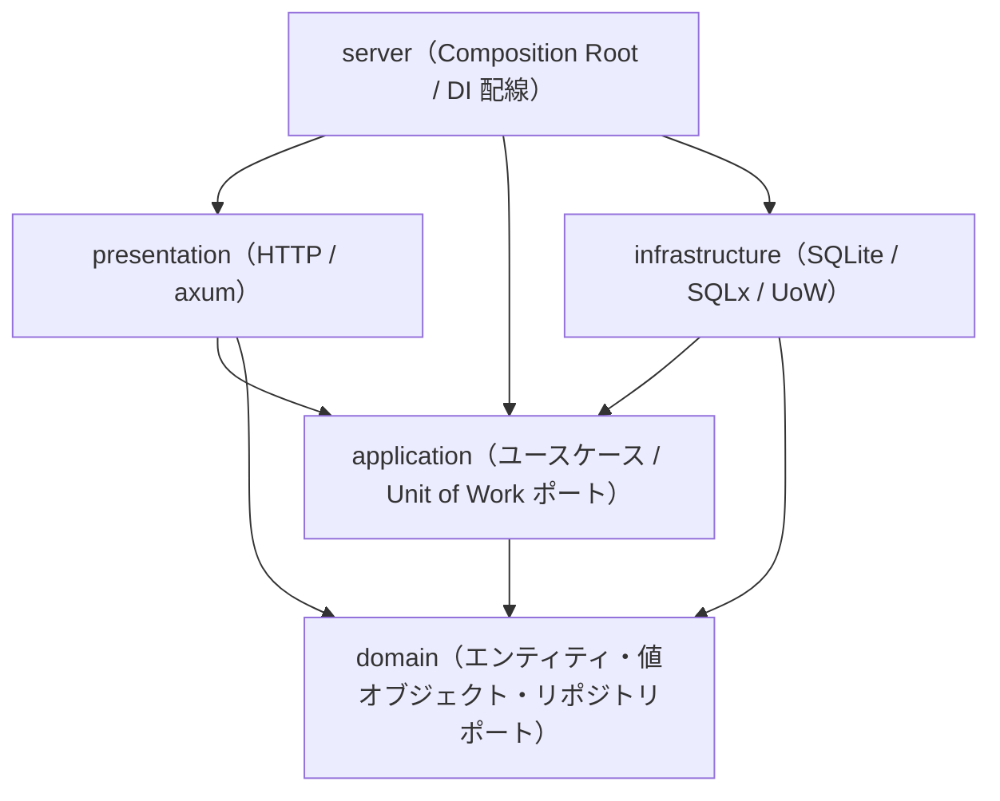

# dddrs

[](https://github.com/iktakahiro/dddrs/actions/workflows/ci.yml)

[English](README.md) | 日本語

[axum](https://github.com/tokio-rs/axum) と [SQLx](https://github.com/launchbadge/sqlx)（SQLite）を用いた、**Rust によるドメイン駆動設計（DDD）およびオニオンアーキテクチャ**の実装サンプルです。

姉妹リポジトリ:
- Python 版: [dddpy](https://github.com/iktakahiro/dddpy)
- Go 版: [oniongo](https://github.com/iktakahiro/oniongo)

> **注意:** このリポジトリはアーキテクチャ設計のベースとなるリファレンスサンプルです。認証・認可・レート制限・本番向けロギング等は意図的に省いています。実サービスへ応用する際は、これらを適切に実装してください。

## 技術スタック

- **言語:** Rust（Edition 2024 / Rust 1.85 以上）
- **Web フレームワーク:** [axum](https://github.com/tokio-rs/axum) 0.8 + [Tokio](https://tokio.rs/)
- **データベース:** [SQLx](https://github.com/launchbadge/sqlx) 0.8 + SQLite（同梱ビルド・マイグレーション付き）
- **エラーハンドリング:** [thiserror](https://github.com/dtolnay/thiserror)
- **日時・ID:** [chrono](https://github.com/chronotope/chrono), [uuid](https://github.com/uuid-rs/uuid)

## クイックスタート

### 前提条件

- **Rust 1.85 以上**（Edition 2024 に必要です。[rustup](https://rustup.rs/) で導入できます）
- **C コンパイラ**（`libsqlite3-sys` が SQLite を同梱ビルドするために必要です。外部の SQLite サーバーや `sqlx-cli` のインストールは不要です）
- `curl`、`jq`（以下の動作確認コマンド用・任意）

### サーバーの起動

```sh
cargo run --locked -p server
```

起動するとカレントディレクトリに `todos.db` が作成され、SQL マイグレーションが自動で適用されます。

| 環境変数 | デフォルト値 | 説明 |
| --- | --- | --- |
| `DATABASE_URL` | `sqlite://todos.db` | SQLite の接続 URL |
| `BIND_ADDR` | `127.0.0.1:3000` | 待受アドレスとポート |

### API の動作確認

このサンプルの核となるドメインルールは **「未開始の Todo は完了できない」** という状態遷移ルールです。

```sh
BASE_URL=http://127.0.0.1:3000

# 1. Todo を作成する
TODO_ID=$(curl -fsS -X POST "$BASE_URL/todos" \
  -H 'Content-Type: application/json' \
  -d '{"title":"夕飯の買い物","description":"野菜を買う"}' \
  | jq -r .id)

# 2. 未開始のまま完了しようとすると 400 Bad Request になる
curl -sS -i -X PATCH "$BASE_URL/todos/$TODO_ID/complete"

# 3. 開始 → 完了
curl -fsS -X PATCH "$BASE_URL/todos/$TODO_ID/start" | jq
curl -fsS -X PATCH "$BASE_URL/todos/$TODO_ID/complete" | jq

# 4. 取得・削除
curl -fsS "$BASE_URL/todos/$TODO_ID" | jq
curl -fsS -i -X DELETE "$BASE_URL/todos/$TODO_ID"
```

レスポンス例（`201 Created`）:

```json
{
  "id": "550e8400-e29b-41d4-a716-446655440000",
  "title": "夕飯の買い物",
  "description": "野菜を買う",
  "status": "not_started",
  "created_at": 1735689600000,
  "updated_at": 1735689600000,
  "completed_at": null
}
```

## アーキテクチャ

Cargo ワークスペースで各層を独立したクレートに分割し、**オニオンアーキテクチャの依存方向をコンパイル時に強制**しています。



### ワークスペース構成

```text
crates/
├── domain/                       # 純粋なビジネスルール（axum / sqlx / serde 非依存）
│   └── src/
│       ├── error.rs              # エンティティ横断の RepositoryError
│       └── todo/
│           ├── entity.rs         # Todo 集約、TodoState ADT、TodoStatus、TransitionError
│           ├── values.rs         # TodoId、Title、Description、ValidationError
│           └── repository.rs     # TodoRepository trait と Snapshot
├── application/                  # 単一責任のユースケース & トランザクションポート
│   └── src/
│       ├── uow.rs                # UnitOfWork / UnitOfWorkFactory trait
│       └── todo/                 # 1 ユースケース = 1 Struct・1 execute() メソッド
│           ├── error.rs          # UseCaseError（RepositoryError を presentation から隠蔽）
│           ├── create_todo.rs
│           ├── find_todo_by_id.rs
│           ├── find_todos.rs
│           ├── update_todo.rs
│           ├── start_todo.rs
│           ├── complete_todo.rs
│           └── delete_todo.rs
├── infrastructure/               # SQLx SQLite プール、Unit of Work、リポジトリ、マイグレーション
│   ├── migrations/
│   └── src/
│       ├── sqlite.rs             # 接続設定（WAL / foreign_keys）& SqliteUnitOfWorkFactory
│       └── todo/
│           ├── repository.rs     # トランザクションに紐づく SqliteTodoRepository
│           └── row.rs            # TodoRow からドメイン Snapshot への再構築
├── presentation/                 # axum ルーター、ハンドラ、Extractor、スキーマ、エラー変換
│   └── src/
│       ├── error.rs              # 共通 ApiError（JSON {"detail": ...}）
│       └── todo/
│           ├── handlers.rs       # TodoUseCases + FromRef によるハンドラ単位の注入
│           ├── extract.rs        # TodoPath / TodoInput Extractor
│           ├── schema.rs         # TodoResponse シリアライズ
│           └── error.rs          # UseCaseError / ValidationError → HTTP ステータス変換
└── server/                       # Composition Root、バイナリ起動、統合テスト・依存方向テスト
    ├── src/
    │   ├── lib.rs                # build_router() / build_sqlite_app()
    │   └── main.rs
    └── tests/
        ├── http.rs               # インプロセス HTTP 統合テスト
        └── layers.rs             # cargo metadata による依存方向検証テスト
```

### クレート間の依存ルール

| クレート | 直接依存できるワークスペース内クレート |
| --- | --- |
| `domain` | なし |
| `application` | `domain` |
| `infrastructure` | `application`、`domain` |
| `presentation` | `application`、`domain` |
| `server` | `presentation`、`application`、`infrastructure` |

別クレートを参照するには自身の `Cargo.toml` に依存宣言が必要なため、たとえば `application` や `domain` から `infrastructure` を参照しようとしてもコンパイルエラーになります。さらに、[`crates/server/tests/layers.rs`](crates/server/tests/layers.rs) が CI 上で `cargo metadata` を検査し、`Cargo.toml` への依存追加による境界違反も防いでいます。

### リクエスト処理の流れ（`PATCH /todos/{id}/start`）

実行時の制御は外側から内側へ呼ばれて戻りますが、コンパイル時の依存関係は常に内側を向きます。

1. **Presentation**（[`handlers.rs`](crates/presentation/src/todo/handlers.rs), [`extract.rs`](crates/presentation/src/todo/extract.rs)）: パスパラメータを `TodoId` へ検証変換し、axum の `FromRef` を通じて `Arc<dyn StartTodoUseCase>` のみを受け取ります。
2. **Application**（[`start_todo.rs`](crates/application/src/todo/start_todo.rs), [`uow.rs`](crates/application/src/uow.rs)）: `UnitOfWorkFactory::begin()` でトランザクションを開始し、スナップショットを読み出して `Todo::start()` を呼び、楽観ロック付きで更新・コミットします（失敗時はロールバックします）。
3. **Domain**（[`entity.rs`](crates/domain/src/todo/entity.rs)）: `NotStarted -> InProgress` の遷移ルールを検証し、不正な遷移は `TransitionError` を返します。
4. **Infrastructure**（[`sqlite.rs`](crates/infrastructure/src/sqlite.rs), [`repository.rs`](crates/infrastructure/src/todo/repository.rs)）: 有効な SQLite トランザクション上で `WHERE id = ? AND version = ?` の楽観ロック付きクエリを実行します。
5. **Server**（[`lib.rs`](crates/server/src/lib.rs)）: 起動時に一度だけ `SqliteUnitOfWorkFactory` を各ユースケースへ配線します。

## 主な設計ポイント

### 1. 代数的データ型（ADT）で不正な状態を表現不可能にする

[`crates/domain/src/todo/entity.rs`](crates/domain/src/todo/entity.rs) では、`Todo` の全フィールドを非公開にし、ライフサイクル状態を enum で表現しています。

```rust
pub enum TodoState {
    NotStarted,
    InProgress,
    Completed { completed_at: DateTime<Utc> },
}
```

`completed_at` を `Completed` バリアントにのみ持たせることで、「未完了なのに完了時刻が入っている」「完了済みなのに完了時刻がない」という不正な状態を**コンパイル時に表現不可能**にしています。単一の `Todo` 型で一貫して扱えるため、状態やエンティティが増えた際にも複雑化しにくい設計です。

### 2. Newtype による値オブジェクトとカプセル化

[`TodoId`・`Title`・`Description`](crates/domain/src/todo/values.rs) は非公開フィールドを持つ newtype とし、生成時（`TryFrom` / `FromStr` / `Description::from_optional`）に不変条件を検証します。型が分かれているため、`Title` と `Description` の取り違えをコンパイル時に防げます。ドメイン層の日時は `DateTime<Utc>` で保持し、Unix ミリ秒やステータス文字列への変換は `infrastructure` と `presentation` の責務に閉じています。

### 3. 1 ユースケース = 1 Struct・1 メソッドの原則

[`crates/application/src/todo/`](crates/application/src/todo) の各操作は、`dddpy`・`oniongo` と同様に独立した trait と構造体（単一の `execute` メソッド）として定義しています。

- `presentation` の各ハンドラは axum の `FromRef` 経由で自分が呼ぶ 1 つのユースケース trait のみに依存するため、DB なしでハンドラ単位の単体テストが書けます。
- 複数エンティティを跨ぐユースケースが増えても、必要な依存だけを注入でき、巨大なサービスクラス化を防げます。
- 将来的に参照系の負荷分離（軽量 CQRS）が必要になった際も、`FindTodosUseCase` など参照側だけ専用 QueryService へ差し替えられます。

### 4. Unit of Work によるトランザクション管理

[`UnitOfWork` / `UnitOfWorkFactory`](crates/application/src/uow.rs) により、`sqlx` の型を内側へ漏らさずにアプリケーション層でトランザクション境界を制御しています。リポジトリの各メソッドが `&mut self` を取ることで、1 つの DB トランザクション上で同時に複数クエリを走らせない制約を Rust の借用チェッカーで自然に表現しています。複数エンティティを跨ぐ更新も同一トランザクションで原子的にコミット／ロールバックできます。

### `dddpy` との設計比較

| 観点 | `dddpy`（Python） | `dddrs`（Rust） |
| --- | --- | --- |
| 層の境界 | パッケージ構成・規約で維持 | Cargo クレート分割 + `cargo metadata` テストで強制 |
| 値オブジェクト | `@dataclass(frozen=True)` | 非公開フィールドの newtype（`TryFrom` / `FromStr`） |
| 状態遷移と不変条件 | `TodoStatus` に対する実行時チェック | `TodoState` ADT（`Completed { completed_at }`） |
| ユースケース | 1 クラス・1 `execute` メソッド + `Protocol` | 1 構造体・1 `execute` メソッド + `trait` |
| トランザクション管理 | リクエスト単位の SQLAlchemy `Session` | 明示的な `UnitOfWork` / `UnitOfWorkFactory` + 楽観ロック |
| DI 配線 | FastAPI `Depends` | `FromRef` + `server::build_router` の Composition Root |

## API リファレンス

| メソッド | パス | 処理内容 | 成功ステータス |
| --- | --- | --- | --- |
| `POST` | `/todos` | Todo の作成 | `201 Created` |
| `GET` | `/todos` | 最新 20 件の一覧取得（作成日時の降順） | `200 OK` |
| `GET` | `/todos/{id}` | 指定 ID の Todo を取得 | `200 OK` |
| `PUT` | `/todos/{id}` | `title` と `description` の置換 | `200 OK` |
| `PATCH` | `/todos/{id}/start` | `not_started` → `in_progress` へ遷移 | `200 OK` |
| `PATCH` | `/todos/{id}/complete` | `in_progress` → `completed` へ遷移 | `200 OK` |
| `DELETE` | `/todos/{id}` | Todo の削除 | `204 No Content` |

### フィールド仕様

- `title`: `POST` / `PUT` のリクエストボディで必須（1〜100 文字）。
- `description`: 任意（最大 1,000 文字）。省略または空文字 `""` を送ると説明をクリアします。レスポンスでは説明なしを空文字 `""` で返します。
- `created_at` / `updated_at` / `completed_at`: Unix エポックからのミリ秒（未完了の `completed_at` は `null`）。

### エラーレスポンス

エラー時はいずれも `{"detail": "<メッセージ>"}` 形式の JSON を返します。

| ステータス | 発生条件 |
| --- | --- |
| `400 Bad Request` | 不正な状態遷移、または JSON 構文エラー |
| `404 Not Found` | 対象の Todo が存在しない |
| `409 Conflict` | 並行更新による競合（最新状態を再取得してリトライが必要） |
| `415 Unsupported Media Type` | `Content-Type: application/json` の欠落・不正 |
| `422 Unprocessable Entity` | UUID 形式不正、必須フィールド欠落、またはドメイン検証エラー |
| `500 Internal Server Error` | 予期しないストレージエラー |

## 別のエンティティを追加する手順

各層ではエンティティごとのモジュール（`todo`）と、エンティティ横断の共通モジュール（`domain::error`、`application::uow`、`infrastructure::sqlite`、`presentation::error`）を分けて配置しています。たとえば `project` エンティティを追加する場合は次のように拡張します。

1. **Domain:** `crates/domain/src/project/` を追加し、エンティティ・値オブジェクト・`ProjectRepository` trait を定義します（`domain::error::RepositoryError` を再利用）。
2. **Application:** [`crates/application/src/uow.rs`](crates/application/src/uow.rs) の `UnitOfWork` に `fn projects(&mut self) -> Box<dyn ProjectRepository + '_>` を追加し、`crates/application/src/project/` に 1 Struct 1 Method のユースケースを配置します。
3. **Infrastructure:** `crates/infrastructure/migrations/` にマイグレーション SQL を追加し、`crates/infrastructure/src/project/` に `SqliteProjectRepository` を実装して [`SqliteUnitOfWork`](crates/infrastructure/src/sqlite.rs) に接続します。
4. **Presentation & Server:** `crates/presentation/src/project/` に `ProjectUseCases` と `router()` を用意し、[`crates/server/src/lib.rs`](crates/server/src/lib.rs) で共通の `Arc<dyn UnitOfWorkFactory>` を渡して `.merge(...)` で統合します。

## 開発・テスト

フォーマット、Clippy、各層の単体テスト、SQLite トランザクションテスト、依存方向テスト、およびインプロセス HTTP 統合テストを一括実行できます。

```sh
cargo fmt --all --check
cargo clippy --workspace --all-targets --locked -- -D warnings
cargo test --workspace --locked
```

各層のテスト内容:
- **`domain`**: ライフサイクル状態遷移、エンティティ同一性、値オブジェクトのバリデーション
- **`application`**: インメモリ `UnitOfWorkFactory` を用いた全ユースケースの単体テストとロールバック検証
- **`infrastructure`**: SQLite 上での楽観ロック、原子的コミット、明示的ロールバック、および Drop 時の自動ロールバック検証
- **`presentation`**: 単一ユースケースのスタブを用いたハンドラのエラーマッピング単体テスト
- **`server`**: DB 再接続を含むインプロセス HTTP 統合テスト、および `cargo metadata` による層間依存テスト

すべてのテストは一時 DB またはインメモリ SQLite を使用するため、ローカルの `todos.db` には影響しません。

### HTTP E2E テスト（Hurl）

通常の統合テストは同一プロセス内で axum の `Router` を直接呼び出します。ビルド済みバイナリに対して実際の TCP 接続でリクエストを送るには、[Hurl をインストール](https://hurl.dev/docs/installation.html)（CI では `8.0.1` を使用）したうえで次を実行します。

```sh
cargo test --locked -p server --test e2e -- --ignored --nocapture
```

テスト実行時に一時 SQLite データベースと空いているループバックポートでサーバーを起動し、[`crates/server/tests/e2e/todos.hurl`](crates/server/tests/e2e/todos.hurl) のシナリオ（作成・未開始完了の拒否・更新・開始・完了・一覧・削除・削除後の 404）を検証したあと、終了時にサーバーを自動停止します。通常のワークスペーステストでは Hurl は不要で、CI がこのテストを明示的に実行します。

## ライセンス

このプロジェクトは MIT ライセンスのもとで公開されています。詳細は [LICENSE](LICENSE) を参照してください。
