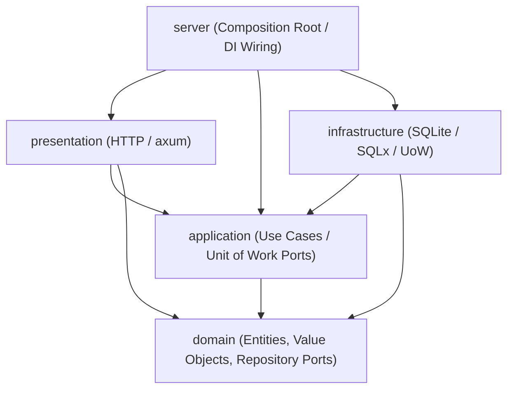

# dddrs

[](https://github.com/iktakahiro/dddrs/actions/workflows/ci.yml)

English | [日本語](README.ja_JP.md)

A practical **Domain-Driven Design (DDD)** and **Onion Architecture** example in **Rust**, built with [axum](https://github.com/tokio-rs/axum) and [SQLx](https://github.com/launchbadge/sqlx) (SQLite).

This repository is the Rust counterpart to:
- Python implementation: [dddpy](https://github.com/iktakahiro/dddpy)
- Go implementation: [oniongo](https://github.com/iktakahiro/oniongo)

> **Note:** This repository is a foundational architecture sample. It intentionally omits authentication, authorization, rate limiting, and production observability. Add those before deploying a derived service to production.

## Tech Stack

- **Language:** Rust (Edition 2024, Rust 1.85+)
- **Web Framework:** [axum](https://github.com/tokio-rs/axum) 0.8 + [Tokio](https://tokio.rs/)
- **Database:** [SQLx](https://github.com/launchbadge/sqlx) 0.8 + SQLite (bundled, with migrations)
- **Error Handling:** [thiserror](https://github.com/dtolnay/thiserror)
- **Timestamps & IDs:** [chrono](https://github.com/chronotope/chrono), [uuid](https://github.com/uuid-rs/uuid)

## Quick Start

### Prerequisites

- **Rust 1.85 or later** (required for Edition 2024; install via [rustup](https://rustup.rs/))
- **A C compiler** (required to compile bundled SQLite via `libsqlite3-sys`; no external SQLite server or `sqlx-cli` is needed)
- `curl` and `jq` (optional, for the examples below)

### Run the Server

```sh
cargo run --locked -p server
```

On startup, the server creates `todos.db` in the current working directory and applies SQL migrations automatically.

| Environment Variable | Default | Description |
| --- | --- | --- |
| `DATABASE_URL` | `sqlite://todos.db` | SQLite connection URL |
| `BIND_ADDR` | `127.0.0.1:3000` | Listen address and port |

### Try the API

The core domain rule in this sample is: **a Todo must be started before it can be completed.**

```sh
BASE_URL=http://127.0.0.1:3000

# 1. Create a Todo
TODO_ID=$(curl -fsS -X POST "$BASE_URL/todos" \
  -H 'Content-Type: application/json' \
  -d '{"title":"Buy groceries","description":"Pick up vegetables"}' \
  | jq -r .id)

# 2. Attempting to complete before starting returns 400 Bad Request
curl -sS -i -X PATCH "$BASE_URL/todos/$TODO_ID/complete"

# 3. Start -> Complete
curl -fsS -X PATCH "$BASE_URL/todos/$TODO_ID/start" | jq
curl -fsS -X PATCH "$BASE_URL/todos/$TODO_ID/complete" | jq

# 4. Fetch & Delete
curl -fsS "$BASE_URL/todos/$TODO_ID" | jq
curl -fsS -i -X DELETE "$BASE_URL/todos/$TODO_ID"
```

Example response (`201 Created`):

```json
{
  "id": "550e8400-e29b-41d4-a716-446655440000",
  "title": "Buy groceries",
  "description": "Pick up vegetables",
  "status": "not_started",
  "created_at": 1735689600000,
  "updated_at": 1735689600000,
  "completed_at": null
}
```

## Architecture

This Cargo workspace enforces **Onion Architecture** boundaries at compile time by isolating each layer in its own crate.



### Workspace Layout

```text
crates/
├── domain/                       # Pure business rules (no axum, sqlx, or serde)
│   └── src/
│       ├── error.rs              # Shared RepositoryError
│       └── todo/
│           ├── entity.rs         # Todo aggregate, TodoState ADT, TodoStatus, TransitionError
│           ├── values.rs         # TodoId, Title, Description, ValidationError
│           └── repository.rs     # TodoRepository trait and Snapshot
├── application/                  # Single-responsibility use cases & transaction ports
│   └── src/
│       ├── uow.rs                # UnitOfWork and UnitOfWorkFactory traits
│       └── todo/                 # One struct and one execute() method per use case
│           ├── error.rs          # UseCaseError (insulates presentation from RepositoryError)
│           ├── create_todo.rs
│           ├── find_todo_by_id.rs
│           ├── find_todos.rs
│           ├── update_todo.rs
│           ├── start_todo.rs
│           ├── complete_todo.rs
│           └── delete_todo.rs
├── infrastructure/               # SQLx SQLite pool, Unit of Work, repositories, migrations
│   ├── migrations/
│   └── src/
│       ├── sqlite.rs             # Pool setup (WAL, foreign_keys) & SqliteUnitOfWorkFactory
│       └── todo/
│           ├── repository.rs     # Transaction-bound SqliteTodoRepository
│           └── row.rs            # TodoRow -> domain Snapshot reconstitution
├── presentation/                 # axum routers, handlers, extractors, schemas, error mapping
│   └── src/
│       ├── error.rs              # Shared ApiError (JSON {"detail": ...})
│       └── todo/
│           ├── handlers.rs       # TodoUseCases + FromRef per-handler injection
│           ├── extract.rs        # TodoPath and TodoInput extractors
│           ├── schema.rs         # TodoResponse serialization
│           └── error.rs          # UseCaseError / ValidationError -> HTTP status
└── server/                       # Composition root, binary entrypoint, integration & layer tests
    ├── src/
    │   ├── lib.rs                # build_router() and build_sqlite_app()
    │   └── main.rs
    └── tests/
        ├── http.rs               # In-process HTTP integration tests
        └── layers.rs             # cargo metadata architectural boundary test
```

### Compile-Time Dependency Rules

| Crate | Allowed Workspace Dependencies |
| --- | --- |
| `domain` | None |
| `application` | `domain` |
| `infrastructure` | `application`, `domain` |
| `presentation` | `application`, `domain` |
| `server` | `presentation`, `application`, `infrastructure` |

Because dependencies are declared per crate in `Cargo.toml`, importing `infrastructure` from `application` or `domain` fails to compile. In addition, [`crates/server/tests/layers.rs`](crates/server/tests/layers.rs) inspects `cargo metadata` in CI to fail the build if anyone widens a crate's manifest dependencies.

### Request Flow (`PATCH /todos/{id}/start`)

Runtime control flows **inward and back out**, while compile-time dependencies always point **inward**:

1. **Presentation** ([`handlers.rs`](crates/presentation/src/todo/handlers.rs), [`extract.rs`](crates/presentation/src/todo/extract.rs)): Parses the path parameter into `TodoId` and extracts only `Arc<dyn StartTodoUseCase>` via axum's `FromRef`.
2. **Application** ([`start_todo.rs`](crates/application/src/todo/start_todo.rs), [`uow.rs`](crates/application/src/uow.rs)): Opens a transaction via `UnitOfWorkFactory::begin()`, loads the Todo snapshot, invokes `Todo::start()`, saves with optimistic locking, and commits (or rolls back on any error).
3. **Domain** ([`entity.rs`](crates/domain/src/todo/entity.rs)): Enforces the `NotStarted -> InProgress` transition rule and returns `TransitionError` if invalid.
4. **Infrastructure** ([`sqlite.rs`](crates/infrastructure/src/sqlite.rs), [`repository.rs`](crates/infrastructure/src/todo/repository.rs)): Runs all repository queries on the active SQLite transaction with `WHERE id = ? AND version = ?` optimistic locking.
5. **Server** ([`lib.rs`](crates/server/src/lib.rs)): Wires `SqliteUnitOfWorkFactory` into all use cases once at startup.

## Key Design Decisions

### 1. Algebraic Data Type (ADT) for Illegal-State Prevention

In [`crates/domain/src/todo/entity.rs`](crates/domain/src/todo/entity.rs), `Todo` keeps all fields private and models lifecycle state with an enum:

```rust
pub enum TodoState {
    NotStarted,
    InProgress,
    Completed { completed_at: DateTime<Utc> },
}
```

Making `completed_at` part of the `Completed` variant makes it **impossible at compile time** to represent an incomplete Todo with a completion timestamp or a completed Todo without one—without splitting the domain into separate typestate and persisted-enum types that become hard to scale across complex multi-entity models.

### 2. Newtype Value Objects & Encapsulation

[`TodoId`, `Title`, and `Description`](crates/domain/src/todo/values.rs) wrap private fields and validate invariants on construction (`TryFrom` / `FromStr` / `Description::from_optional`). Distinct types prevent accidentally swapping a title and a description. Domain timestamps use `DateTime<Utc>`, while Unix millisecond encoding and status strings are confined to `infrastructure` and `presentation`.

### 3. One Struct, One Method per Use Case

Each operation in [`crates/application/src/todo/`](crates/application/src/todo) is implemented as its own trait and struct with a single `execute` method (matching `dddpy` and `oniongo`):

- Handlers in `presentation` depend on only the single use case trait they call (injected via axum `FromRef`), enabling isolated handler unit tests without a database.
- Cross-entity use cases can inject only the dependencies they need instead of bloating a god service.
- If read workloads later require lightweight CQRS, read use cases such as `FindTodosUseCase` can switch to a dedicated query service without changing write use cases.

### 4. Transactional Unit of Work

[`UnitOfWork` and `UnitOfWorkFactory`](crates/application/src/uow.rs) place transaction boundaries in the application layer without leaking `sqlx` types inward. Repository methods take `&mut self`, matching Rust's ownership rules for a single SQLite transaction without runtime mutexes. When adding another entity, adding a repository accessor to `UnitOfWork` allows cross-aggregate updates to commit or roll back atomically.

### Comparison with `dddpy`

| Concept | `dddpy` (Python) | `dddrs` (Rust) |
| --- | --- | --- |
| Layer boundaries | Package conventions | Enforced by Cargo crates + `cargo metadata` test |
| Value objects | `@dataclass(frozen=True)` | Private-field newtypes (`TryFrom` / `FromStr`) |
| Lifecycle invariants | Runtime checks on `TodoStatus` | `TodoState` ADT (`Completed { completed_at }`) |
| Use cases | 1 class / 1 `execute` method + `Protocol` | 1 struct / 1 `execute` method + `trait` |
| Transaction management | Per-request SQLAlchemy `Session` | Explicit `UnitOfWork` / `UnitOfWorkFactory` + optimistic locking |
| DI wiring | FastAPI `Depends` | `FromRef` + composition root in `server::build_router` |

## API Reference

| Method | Path | Description | Success |
| --- | --- | --- | --- |
| `POST` | `/todos` | Create a Todo | `201 Created` |
| `GET` | `/todos` | List latest 20 Todos (newest first) | `200 OK` |
| `GET` | `/todos/{id}` | Get a Todo by ID | `200 OK` |
| `PUT` | `/todos/{id}` | Replace `title` and `description` | `200 OK` |
| `PATCH` | `/todos/{id}/start` | Transition `not_started` -> `in_progress` | `200 OK` |
| `PATCH` | `/todos/{id}/complete` | Transition `in_progress` -> `completed` | `200 OK` |
| `DELETE` | `/todos/{id}` | Delete a Todo | `204 No Content` |

### Field Rules

- `title`: Required on `POST` and `PUT`, 1–100 Unicode characters.
- `description`: Optional, up to 1,000 Unicode characters. Omitting it (or sending `""`) clears the description. Responses serialize an absent description as `""`.
- `created_at`, `updated_at`, `completed_at`: Unix timestamps in milliseconds (`completed_at` is `null` until completed).

### Error Responses

All API errors return JSON in the form `{"detail": "<message>"}`:

| Status | Meaning |
| --- | --- |
| `400 Bad Request` | Invalid lifecycle transition or malformed JSON body |
| `404 Not Found` | Todo does not exist |
| `409 Conflict` | Concurrent modification detected (re-read and retry) |
| `415 Unsupported Media Type` | Missing or invalid `Content-Type: application/json` |
| `422 Unprocessable Entity` | Invalid UUID, missing required field, or domain validation failure |
| `500 Internal Server Error` | Unexpected storage error |

## Adding Another Entity

Each layer keeps entity code under its own module (`todo`) alongside shared cross-entity modules (`domain::error`, `application::uow`, `infrastructure::sqlite`, `presentation::error`). To add a sibling entity (for example, `project`):

1. **Domain:** Add `crates/domain/src/project/` with its entity, value objects, and `ProjectRepository` trait (reusing `domain::error::RepositoryError`).
2. **Application:** Add a `fn projects(&mut self) -> Box<dyn ProjectRepository + '_>` accessor to `UnitOfWork` in [`crates/application/src/uow.rs`](crates/application/src/uow.rs), then add 1-struct-1-method use cases under `crates/application/src/project/`.
3. **Infrastructure:** Add a SQL migration in `crates/infrastructure/migrations/`, implement `SqliteProjectRepository` under `crates/infrastructure/src/project/`, and wire `projects()` in [`SqliteUnitOfWork`](crates/infrastructure/src/sqlite.rs).
4. **Presentation & Server:** Add `crates/presentation/src/project/` with `ProjectUseCases` and `router()`, then instantiate and `.merge(...)` it in [`crates/server/src/lib.rs`](crates/server/src/lib.rs) using the same `Arc<dyn UnitOfWorkFactory>`.

## Development & Testing

Run formatting, Clippy, unit tests across every layer, transactional SQLite tests, architecture boundary checks, and in-process HTTP integration tests:

```sh
cargo fmt --all --check
cargo clippy --workspace --all-targets --locked -- -D warnings
cargo test --workspace --locked
```

Test coverage by layer:
- **`domain`**: Entity lifecycle rules, identity equality, value object validation
- **`application`**: Use case behavior and rollback semantics against an in-memory `UnitOfWorkFactory`
- **`infrastructure`**: Optimistic locking, atomic commits, explicit rollback, and drop rollback against SQLite
- **`presentation`**: Isolated handler error-mapping unit tests with single-use-case stubs
- **`server`**: Full in-process HTTP integration tests (including database reopen) and `cargo metadata` layer dependency verification

All tests use temporary or in-memory SQLite databases and never touch your local `todos.db`.

## License

This project is licensed under the MIT License. See [LICENSE](LICENSE) for details.
