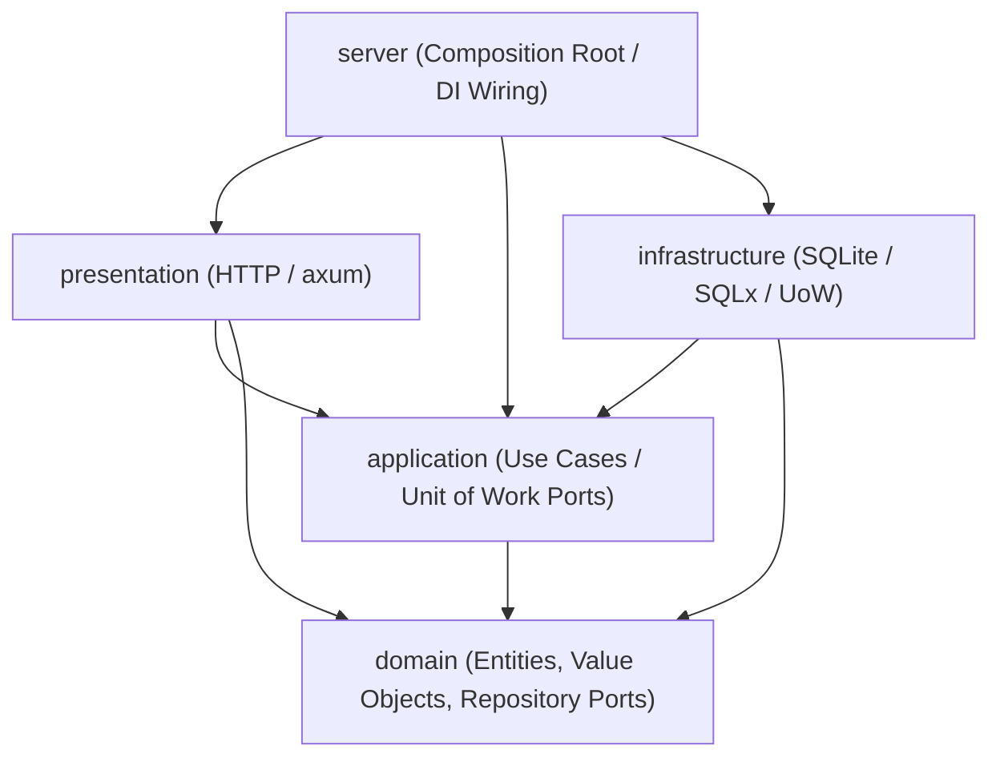

# dddrs

[](https://github.com/iktakahiro/dddrs/actions/workflows/ci.yml)

English | [日本語](README.ja_JP.md)

A practical **Domain-Driven Design (DDD)** and **Onion Architecture** example and layer-by-layer reference guide in **Rust**, built with [axum](https://github.com/tokio-rs/axum) and [SQLx](https://github.com/launchbadge/sqlx) (SQLite).

This repository is the Rust counterpart to:
- Python implementation: [dddpy](https://github.com/iktakahiro/dddpy)
- Go implementation: [oniongo](https://github.com/iktakahiro/oniongo)

> **Note:** This repository is a foundational architecture sample. It intentionally omits authentication, authorization, rate limiting, and production observability. Add those before deploying a derived service to production.

## Tech Stack

- **Language:** Rust (Edition 2024, Rust 1.85+)
- **Web Framework:** [axum](https://github.com/tokio-rs/axum) 0.8 + [Tokio](https://tokio.rs/)
- **Database:** [SQLx](https://github.com/launchbadge/sqlx) 0.8 + SQLite (bundled, with migrations)
- **Error Handling:** [thiserror](https://github.com/dtolnay/thiserror)
- **Timestamps & IDs:** [chrono](https://github.com/chronotope/chrono), [uuid](https://github.com/uuid-rs/uuid)
- **E2E Testing (optional):** [Hurl](https://hurl.dev/)

## Quick Start

### Prerequisites

- **Rust 1.85 or later** (required for Edition 2024; install via [rustup](https://rustup.rs/))
- **A C compiler** (required to compile bundled SQLite via `libsqlite3-sys`; no external SQLite server or `sqlx-cli` is needed)
- `curl` and `jq` (optional, for the examples below)

### Run the Server

```sh
cargo run --locked -p server
```

On startup, the server creates `todos.db` in the current working directory and applies SQL migrations automatically.

| Environment Variable | Default | Description |
| --- | --- | --- |
| `DATABASE_URL` | `sqlite://todos.db` | SQLite connection URL |
| `BIND_ADDR` | `127.0.0.1:3000` | Listen address and port |

### Try the API

The core domain rule in this sample is: **a Todo must be started before it can be completed.**

```sh
BASE_URL=http://127.0.0.1:3000

# 1. Create a Todo
TODO_ID=$(curl -fsS -X POST "$BASE_URL/todos" \
  -H 'Content-Type: application/json' \
  -d '{"title":"Buy groceries","description":"Pick up vegetables"}' \
  | jq -r .id)

# 2. Attempting to complete before starting returns 400 Bad Request
curl -sS -i -X PATCH "$BASE_URL/todos/$TODO_ID/complete"

# 3. Start -> Complete
curl -fsS -X PATCH "$BASE_URL/todos/$TODO_ID/start" | jq
curl -fsS -X PATCH "$BASE_URL/todos/$TODO_ID/complete" | jq

# 4. Fetch & Delete
curl -fsS "$BASE_URL/todos/$TODO_ID" | jq
curl -fsS -i -X DELETE "$BASE_URL/todos/$TODO_ID"
```

Example response (`201 Created`):

```json
{
  "id": "550e8400-e29b-41d4-a716-446655440000",
  "title": "Buy groceries",
  "description": "Pick up vegetables",
  "status": "not_started",
  "created_at": 1735689600000,
  "updated_at": 1735689600000,
  "completed_at": null
}
```

## Architecture Overview

This Cargo workspace enforces **Onion Architecture** boundaries at compile time by isolating each layer in its own crate.



### Workspace Layout

```text
crates/
├── domain/                       # Pure business rules (no axum, sqlx, or serde)
│   └── src/
│       ├── error.rs              # Shared RepositoryError
│       └── todo/
│           ├── entity.rs         # Todo aggregate, TodoState ADT, TodoStatus, TransitionError
│           ├── values.rs         # TodoId, Title, Description, ValidationError
│           └── repository.rs     # TodoRepository trait and Snapshot
├── application/                  # Single-responsibility use cases & transaction ports
│   └── src/
│       ├── uow.rs                # UnitOfWork and UnitOfWorkFactory traits
│       └── todo/                 # One struct and one execute() method per use case
│           ├── error.rs          # UseCaseError (insulates presentation from RepositoryError)
│           ├── create_todo.rs
│           ├── find_todo_by_id.rs
│           ├── find_todos.rs
│           ├── update_todo.rs
│           ├── start_todo.rs
│           ├── complete_todo.rs
│           └── delete_todo.rs
├── infrastructure/               # SQLx SQLite pool, Unit of Work, repositories, migrations
│   ├── migrations/
│   └── src/
│       ├── sqlite.rs             # Pool setup (WAL, foreign_keys) & SqliteUnitOfWorkFactory
│       └── todo/
│           ├── repository.rs     # Transaction-bound SqliteTodoRepository
│           └── row.rs            # TodoRow -> domain Snapshot reconstitution
├── presentation/                 # axum routers, handlers, extractors, schemas, error mapping
│   └── src/
│       ├── error.rs              # Shared ApiError (JSON {"detail": ...})
│       └── todo/
│           ├── handlers.rs       # TodoUseCases + FromRef per-handler injection
│           ├── extract.rs        # TodoPath and TodoInput extractors
│           ├── schema.rs         # TodoResponse serialization
│           └── error.rs          # UseCaseError / ValidationError -> HTTP status
└── server/                       # Composition root, binary entrypoint, integration & E2E tests
    ├── src/
    │   ├── lib.rs                # build_router() and build_sqlite_app()
    │   └── main.rs
    └── tests/
        ├── http.rs               # In-process HTTP integration tests
        ├── layers.rs             # cargo metadata architectural boundary test
        ├── e2e.rs                # Live-server Hurl runner
        └── e2e/todos.hurl        # HTTP end-to-end scenario
```

### Compile-Time Dependency Rules

| Crate | Allowed Workspace Dependencies |
| --- | --- |
| `domain` | None |
| `application` | `domain` |
| `infrastructure` | `application`, `domain` |
| `presentation` | `application`, `domain` |
| `server` | `presentation`, `application`, `infrastructure` |

Because dependencies are declared per crate in `Cargo.toml`, importing `infrastructure` from `application` or `domain` fails to compile. In addition, [`crates/server/tests/layers.rs`](crates/server/tests/layers.rs) inspects `cargo metadata` in CI to fail the build if anyone widens a crate's manifest dependencies or leaks `axum` / `sqlx` into inner crates.

### Request Flow (`PATCH /todos/{id}/start`)

Runtime control flows **inward and back out**, while compile-time dependencies always point **inward**:

1. **Presentation** ([`handlers.rs`](crates/presentation/src/todo/handlers.rs), [`extract.rs`](crates/presentation/src/todo/extract.rs)): Parses the path parameter into `TodoId` and extracts only `Arc<dyn StartTodoUseCase>` via axum's `FromRef`.
2. **Application** ([`start_todo.rs`](crates/application/src/todo/start_todo.rs), [`uow.rs`](crates/application/src/uow.rs)): Opens a transaction via `UnitOfWorkFactory::begin()`, loads the Todo snapshot, invokes `Todo::start()`, saves with optimistic locking, and commits (or rolls back on any error).
3. **Domain** ([`entity.rs`](crates/domain/src/todo/entity.rs)): Enforces the `NotStarted -> InProgress` transition rule and returns `TransitionError` if invalid.
4. **Infrastructure** ([`sqlite.rs`](crates/infrastructure/src/sqlite.rs), [`repository.rs`](crates/infrastructure/src/todo/repository.rs)): Runs all repository queries on the active SQLite transaction with `WHERE id = ? AND version = ?` optimistic locking.
5. **Server** ([`lib.rs`](crates/server/src/lib.rs)): Wires `SqliteUnitOfWorkFactory` into all use cases once at startup.

## Layer-by-Layer Design Guide

This section serves as a practical reference for what belongs in each layer—and just as importantly, what does **not**. Every code listing below is taken directly from this repository.

### Responsibility Summary

| Layer | Should Do | Should NOT Do |
| --- | --- | --- |
| **Domain** (`crates/domain`) | Model entities, value objects, invariants, domain errors, and repository traits | Depend on HTTP, JSON/`serde`, SQL/`sqlx`, or transaction control |
| **Application** (`crates/application`) | Orchestrate 1-struct-1-method use cases, control transaction boundaries (`UnitOfWork`), translate persistence errors | Duplicate entity business rules, write SQL, return HTTP status codes, or bundle unrelated operations into a god service |
| **Infrastructure** (`crates/infrastructure`) | Implement `UnitOfWork` and repository traits, own SQL/migrations/pool config, map rows ↔ domain models | Make business transition decisions, hardcode application limits (`LIMIT 20`), handle HTTP, or leak `sqlx` types outward |
| **Presentation** (`crates/presentation`) | Route HTTP requests, extract/validate payloads, call a single use case per handler, serialize responses & map HTTP errors | Access repositories/DB directly, manage transactions, implement business rules, inspect `RepositoryError`, or construct concrete `*Impl` structs |
| **Server** (`crates/server`) | Read config/env, wire concrete implementations into traits, merge routers, start the listener | Contain business logic, execute SQL directly, or define HTTP handlers/DTOs |

---

### 1. Domain Layer (`crates/domain`)

The center of the onion. It expresses the business model and rules using pure Rust types with zero knowledge of HTTP frameworks or databases.

#### What this layer SHOULD do
- Define **aggregates and entities** with private fields and behavior methods that protect invariants.
- Use Rust's **Algebraic Data Types (enums with data)** to make illegal states unrepresentable.
- Define **value objects** as validated newtypes (`TryFrom` / `FromStr` / `from_optional`) so primitive types cannot be confused.
- Define **repository traits (ports)** and shared domain/persistence error enums (`TransitionError`, `ValidationError`, `RepositoryError`).
- Represent domain concepts with proper types (`DateTime<Utc>`, `TodoStatus`), not wire-format primitives.

#### What this layer SHOULD NOT do
- **Do not** import `axum`, `sqlx`, or `serde` (no `#[derive(Serialize, Deserialize)]` or `#[derive(sqlx::FromRow)]` on domain entities).
- **Do not** hardcode DB column strings or JSON representations inside entity methods (e.g., returning `"not_started"` strings from the entity).
- **Do not** start, commit, or roll back database transactions.
- **Do not** expose mutable public fields that allow callers to bypass domain invariants.

#### Code Examples

**Entity & ADT state ([`crates/domain/src/todo/entity.rs`](crates/domain/src/todo/entity.rs)):**

Making `completed_at` part of `TodoState::Completed` ensures at compile time that an incomplete Todo can never hold a completion timestamp and a completed Todo always has one. `PartialEq` compares only `id`, following DDD entity identity semantics.

```rust
/// Coarse lifecycle status of a Todo.
#[derive(Debug, Clone, Copy, PartialEq, Eq, Hash)]
pub enum TodoStatus {
    NotStarted,
    InProgress,
    Completed,
}

/// Lifecycle state of a Todo.
///
/// Storing `completed_at` inside the `Completed` variant makes illegal states
/// unrepresentable: an incomplete Todo cannot carry a completion timestamp, and
/// a completed Todo always carries one.
#[derive(Debug, Clone, Copy, PartialEq, Eq)]
pub enum TodoState {
    NotStarted,
    InProgress,
    Completed { completed_at: DateTime<Utc> },
}

#[derive(Debug, Clone, PartialEq, Eq, Error)]
pub enum TransitionError {
    #[error("Todo has not been started")]
    NotStarted,
    #[error("Todo has already been started")]
    AlreadyStarted,
    #[error("Todo has already been completed")]
    AlreadyCompleted,
}

#[derive(Debug, Clone)]
pub struct Todo {
    id: TodoId,
    title: Title,
    description: Option<Description>,
    state: TodoState,
    created_at: DateTime<Utc>,
    updated_at: DateTime<Utc>,
}

impl Todo {
    pub fn start_at(&mut self, now: DateTime<Utc>) -> Result<(), TransitionError> {
        match self.state {
            TodoState::NotStarted => {
                self.state = TodoState::InProgress;
                self.updated_at = now;
                Ok(())
            }
            TodoState::InProgress => Err(TransitionError::AlreadyStarted),
            TodoState::Completed { .. } => Err(TransitionError::AlreadyCompleted),
        }
    }

    pub fn complete_at(&mut self, now: DateTime<Utc>) -> Result<(), TransitionError> {
        match self.state {
            TodoState::NotStarted => Err(TransitionError::NotStarted),
            TodoState::InProgress => {
                self.state = TodoState::Completed { completed_at: now };
                self.updated_at = now;
                Ok(())
            }
            TodoState::Completed { .. } => Err(TransitionError::AlreadyCompleted),
        }
    }
}

impl PartialEq for Todo {
    fn eq(&self, other: &Self) -> bool {
        self.id == other.id
    }
}
```

**Value objects ([`crates/domain/src/todo/values.rs`](crates/domain/src/todo/values.rs)):**

Validation and normalization rules live inside the value object constructors rather than being scattered across HTTP handlers. `Description::from_optional` normalizes `Some("")` to `None` so there is only one representation of an absent description.

```rust
#[derive(Debug, Clone, PartialEq, Eq, Hash)]
pub struct Title(String);

impl TryFrom<String> for Title {
    type Error = ValidationError;

    fn try_from(raw: String) -> Result<Self, Self::Error> {
        if raw.is_empty() || raw.chars().count() > 100 {
            return Err(ValidationError::Title);
        }
        Ok(Self(raw))
    }
}

#[derive(Debug, Clone, PartialEq, Eq, Hash)]
pub struct Description(String);

impl Description {
    /// Normalize an optional raw description into a domain value.
    ///
    /// Both `None` and an empty string represent an absent description (`None`),
    /// avoiding duplicate representations of emptiness.
    pub fn from_optional(raw: Option<String>) -> Result<Option<Self>, ValidationError> {
        match raw {
            None => Ok(None),
            Some(value) if value.is_empty() => Ok(None),
            Some(value) => Self::try_from(value).map(Some),
        }
    }
}
```

**Repository port & shared error ([`crates/domain/src/todo/repository.rs`](crates/domain/src/todo/repository.rs), [`crates/domain/src/error.rs`](crates/domain/src/error.rs)):**

The trait is defined in `domain` (Dependency Inversion Principle) and takes `&mut self` so implementations can operate directly on an active database transaction without interior locks. `RepositoryError` lives in `domain::error` so sibling entities can reuse it.

```rust
#[derive(Debug, Clone)]
pub struct Snapshot {
    pub todo: Todo,
    pub version: i64,
}

#[async_trait]
pub trait TodoRepository: Send {
    async fn insert(&mut self, todo: &Todo) -> Result<(), RepositoryError>;
    async fn find_by_id(&mut self, id: TodoId) -> Result<Option<Snapshot>, RepositoryError>;
    async fn find_latest(&mut self, limit: u32) -> Result<Vec<Todo>, RepositoryError>;
    async fn update(&mut self, todo: &Todo, expected_version: i64) -> Result<(), RepositoryError>;
    async fn delete(&mut self, id: TodoId) -> Result<bool, RepositoryError>;
}
```

---

### 2. Application Layer (`crates/application`)

Coordinates domain objects and persistence ports to fulfill concrete user-facing operations. Each operation is modeled as a dedicated use case.

#### What this layer SHOULD do
- Follow the **1 Struct = 1 `execute` Method** principle: one file, one trait port, and one implementation struct per use case.
- Define **transactional boundaries** through `UnitOfWork` / `UnitOfWorkFactory` ports, committing on success and rolling back on error.
- Own application-level parameters and policies (such as `DEFAULT_LIST_LIMIT = 20`).
- Translate low-level `RepositoryError` into application-level `UseCaseError` so outer layers do not depend on repository internals.
- Provide fast unit tests using an in-memory `UnitOfWorkFactory` without touching a real database.

#### What this layer SHOULD NOT do
- **Do not** re-implement business rules (e.g., checking `todo.status() == TodoStatus::NotStarted` inside a use case instead of calling `todo.complete()`).
- **Do not** depend on `infrastructure`, `presentation`, `sqlx`, or `axum`.
- **Do not** aggregate unrelated CRUD operations into a single monolithic `TodoService` struct (which breaks down as soon as use cases span multiple entities).
- **Do not** return HTTP status codes or JSON DTOs.

#### Code Examples

**Unit of Work ports ([`crates/application/src/uow.rs`](crates/application/src/uow.rs)):**

Transactions are an application concern, not a domain concern. Adding a second entity (e.g., `Project`) means adding one repository accessor method here so a single use case can update both aggregates atomically.

```rust
#[async_trait]
pub trait UnitOfWork: Send {
    fn todos(&mut self) -> Box<dyn TodoRepository + '_>;

    async fn commit(self: Box<Self>) -> Result<(), RepositoryError>;
    async fn rollback(self: Box<Self>) -> Result<(), RepositoryError>;
}

#[async_trait]
pub trait UnitOfWorkFactory: Send + Sync {
    async fn begin(&self) -> Result<Box<dyn UnitOfWork>, RepositoryError>;
}
```

**1-Struct-1-Method use case ([`crates/application/src/todo/create_todo.rs`](crates/application/src/todo/create_todo.rs)):**

```rust
#[async_trait]
pub trait CreateTodoUseCase: Send + Sync {
    async fn execute(
        &self,
        title: Title,
        description: Option<Description>,
    ) -> Result<Todo, UseCaseError>;
}

pub struct CreateTodoUseCaseImpl {
    uow_factory: Arc<dyn UnitOfWorkFactory>,
}

impl CreateTodoUseCaseImpl {
    pub fn new(uow_factory: Arc<dyn UnitOfWorkFactory>) -> Self {
        Self { uow_factory }
    }
}

#[async_trait]
impl CreateTodoUseCase for CreateTodoUseCaseImpl {
    async fn execute(
        &self,
        title: Title,
        description: Option<Description>,
    ) -> Result<Todo, UseCaseError> {
        let mut uow = self.uow_factory.begin().await?;
        let todo = Todo::new(title, description);
        let inserted = uow.todos().insert(&todo).await;
        if let Err(error) = inserted {
            let _ = uow.rollback().await;
            return Err(error.into());
        }
        uow.commit().await?;
        Ok(todo)
    }
}
```

**Shared transactional helper & state-transition use case ([`crates/application/src/todo.rs`](crates/application/src/todo.rs), [`crates/application/src/todo/start_todo.rs`](crates/application/src/todo/start_todo.rs)):**

Common load → mutate → optimistic-lock update → commit/rollback flow is kept private inside `application::todo`, keeping each individual use case concise and focused.

```rust
async fn update_in_tx(
    uow_factory: &dyn UnitOfWorkFactory,
    id: TodoId,
    mutate: impl FnOnce(&mut Todo) -> Result<(), TransitionError>,
) -> Result<Todo, UseCaseError> {
    let mut uow = uow_factory.begin().await?;
    let result: Result<Todo, UseCaseError> = async {
        let snapshot = uow
            .todos()
            .find_by_id(id)
            .await?
            .ok_or(UseCaseError::NotFound)?;
        let mut todo = snapshot.todo;
        mutate(&mut todo)?;
        uow.todos().update(&todo, snapshot.version).await?;
        Ok(todo)
    }
    .await;

    match result {
        Ok(todo) => {
            uow.commit().await?;
            Ok(todo)
        }
        Err(error) => {
            let _ = uow.rollback().await;
            Err(error)
        }
    }
}

// crates/application/src/todo/start_todo.rs
#[async_trait]
impl StartTodoUseCase for StartTodoUseCaseImpl {
    async fn execute(&self, id: TodoId) -> Result<Todo, UseCaseError> {
        update_in_tx(self.uow_factory.as_ref(), id, Todo::start).await
    }
}
```

**Error translation ([`crates/application/src/todo/error.rs`](crates/application/src/todo/error.rs)):**

```rust
#[derive(Debug, Error)]
pub enum UseCaseError {
    #[error("Todo not found")]
    NotFound,
    #[error(transparent)]
    Transition(#[from] TransitionError),
    #[error("Todo changed since it was read")]
    Conflict,
    #[error("Unexpected repository failure")]
    Unexpected(#[source] Box<dyn Error + Send + Sync>),
}

impl From<RepositoryError> for UseCaseError {
    fn from(error: RepositoryError) -> Self {
        match error {
            RepositoryError::Conflict => Self::Conflict,
            RepositoryError::Storage(source) => Self::Unexpected(source),
        }
    }
}
```

> **Design note — Use Case traits vs. concrete structs:** This repository defines a `*UseCase` trait alongside each `*UseCaseImpl` struct (matching `dddpy` and `oniongo`) so presentation handlers depend only on abstractions and can be unit-tested with single-use-case stubs. In a production codebase that wants less boilerplate, you can keep the 1-struct-1-method structure while dropping the use case traits and keeping traits only at the `UnitOfWork` / repository boundary.

---

### 3. Infrastructure Layer (`crates/infrastructure`)

Adapts external technologies (here, SQLite via SQLx) to the traits defined in `domain` and `application`.

#### What this layer SHOULD do
- Implement `UnitOfWorkFactory`, `UnitOfWork`, and repository traits (`TodoRepository`).
- Own database connection configuration (`foreign_keys`, WAL mode, `busy_timeout`, SQL migrations).
- Translate between database rows (`TodoRow`, SQL strings, millisecond integers) and domain objects (`Todo::reconstitute`, `TodoStatus`, `DateTime<Utc>`).
- Enforce persistence-level safeguards: explicit SQL column lists (avoiding `SELECT *`), parameterized `LIMIT ?`, and optimistic-locking `WHERE id = ? AND version = ?` checks.
- Convert `sqlx::Error` into `RepositoryError` at the boundary.

#### What this layer SHOULD NOT do
- **Do not** decide domain rules (such as whether a transition is permitted).
- **Do not** hardcode application-level policies like `LIMIT 20` inside SQL queries—accept them as parameters from the use case.
- **Do not** expose `TodoRow`, `sqlx::Error`, or raw `Transaction` types to inner layers or `presentation`.
- **Do not** depend on `presentation` or `axum`.

#### Code Examples

**SQLite setup & Unit of Work implementation ([`crates/infrastructure/src/sqlite.rs`](crates/infrastructure/src/sqlite.rs)):**

```rust
pub async fn connect(url: &str) -> Result<SqlitePool, sqlx::Error> {
    let options = url
        .parse::<SqliteConnectOptions>()?
        .create_if_missing(true)
        .foreign_keys(true)
        .journal_mode(SqliteJournalMode::Wal)
        .busy_timeout(Duration::from_secs(5));

    // In-memory SQLite creates an isolated database per connection unless capped at 1.
    let pool = if url == "sqlite::memory:" {
        SqlitePoolOptions::new()
            .max_connections(1)
            .connect_with(options)
            .await?
    } else {
        SqlitePool::connect_with(options).await?
    };

    sqlx::migrate!().run(&pool).await?;
    Ok(pool)
}

#[async_trait]
impl UnitOfWorkFactory for SqliteUnitOfWorkFactory {
    async fn begin(&self) -> Result<Box<dyn UnitOfWork>, RepositoryError> {
        let tx = self.pool.begin().await.map_err(storage)?;
        Ok(Box::new(SqliteUnitOfWork { tx }))
    }
}

#[async_trait]
impl UnitOfWork for SqliteUnitOfWork {
    fn todos(&mut self) -> Box<dyn TodoRepository + '_> {
        Box::new(SqliteTodoRepository::new(&mut self.tx))
    }

    async fn commit(self: Box<Self>) -> Result<(), RepositoryError> {
        self.tx.commit().await.map_err(storage)
    }

    async fn rollback(self: Box<Self>) -> Result<(), RepositoryError> {
        self.tx.rollback().await.map_err(storage)
    }
}
```

**Transaction-bound repository & optimistic locking ([`crates/infrastructure/src/todo/repository.rs`](crates/infrastructure/src/todo/repository.rs)):**

Status-to-column mapping lives here rather than in `domain`, so changing database representations never touches domain types.

```rust
const SELECT_COLUMNS: &str =
    "id, title, description, status, created_at, updated_at, completed_at, version";

fn status_column(status: TodoStatus) -> &'static str {
    match status {
        TodoStatus::NotStarted => "not_started",
        TodoStatus::InProgress => "in_progress",
        TodoStatus::Completed => "completed",
    }
}

#[async_trait]
impl TodoRepository for SqliteTodoRepository<'_> {
    async fn find_latest(&mut self, limit: u32) -> Result<Vec<Todo>, RepositoryError> {
        let query = format!(
            "SELECT {SELECT_COLUMNS} FROM todos ORDER BY created_at DESC, rowid DESC LIMIT ?"
        );
        sqlx::query_as::<_, TodoRow>(&query)
            .bind(i64::from(limit))
            .fetch_all(&mut **self.tx)
            .await
            .map_err(storage)?
            .into_iter()
            .map(|row| Ok(Snapshot::try_from(row)?.todo))
            .collect()
    }

    async fn update(&mut self, todo: &Todo, expected_version: i64) -> Result<(), RepositoryError> {
        let result = sqlx::query(
            "UPDATE todos SET title = ?, description = ?, status = ?, updated_at = ?, completed_at = ?, version = version + 1 WHERE id = ? AND version = ?",
        )
        .bind(todo.title().as_str())
        .bind(todo.description().map(Description::as_str))
        .bind(status_column(todo.status()))
        .bind(todo.updated_at().timestamp_millis())
        .bind(todo.completed_at().map(|at| at.timestamp_millis()))
        .bind(todo.id().to_string())
        .bind(expected_version)
        .execute(&mut **self.tx)
        .await
        .map_err(storage)?;
        if result.rows_affected() == 0 {
            return Err(RepositoryError::Conflict);
        }
        Ok(())
    }
}
```

**Row-to-domain reconstitution ([`crates/infrastructure/src/todo/row.rs`](crates/infrastructure/src/todo/row.rs)):**

```rust
#[derive(sqlx::FromRow)]
pub(super) struct TodoRow {
    id: String,
    title: String,
    description: Option<String>,
    status: String,
    created_at: i64,
    updated_at: i64,
    completed_at: Option<i64>,
    version: i64,
}

impl TryFrom<TodoRow> for Snapshot {
    type Error = RepositoryError;

    fn try_from(row: TodoRow) -> Result<Self, Self::Error> {
        let id = row.id.parse().map_err(storage)?;
        let title = Title::try_from(row.title).map_err(storage)?;
        let description = Description::from_optional(row.description).map_err(storage)?;
        let created_at = timestamp_from_millis(row.created_at)?;
        let updated_at = timestamp_from_millis(row.updated_at)?;

        let state = match (row.status.as_str(), row.completed_at) {
            ("not_started", None) => TodoState::NotStarted,
            ("in_progress", None) => TodoState::InProgress,
            ("completed", Some(at)) => TodoState::Completed {
                completed_at: timestamp_from_millis(at)?,
            },
            _ => return Err(RepositoryError::Storage("Invalid stored Todo state".into())),
        };

        let todo = Todo::reconstitute(id, title, description, state, created_at, updated_at);
        Ok(Snapshot {
            todo,
            version: row.version,
        })
    }
}
```

---

### 4. Presentation Layer (`crates/presentation`)

Translates between HTTP (axum requests, JSON payloads, status codes) and the application's use case ports.

#### What this layer SHOULD do
- Define routes and HTTP handlers (`axum::Router`).
- Parse and validate HTTP inputs into domain value objects via custom axum extractors (`TodoPath`, `TodoInput`).
- Inject **only the single use case trait** each handler needs using axum's `FromRef`.
- Own API response DTOs (`TodoResponse`), JSON field formatting (millisecond timestamps, status strings), and HTTP error mapping (`UseCaseError` / `ValidationError` → `ApiError`).

#### What this layer SHOULD NOT do
- **Do not** import `infrastructure`, `sqlx`, or concrete `*UseCaseImpl` types.
- **Do not** open transactions or call repositories directly.
- **Do not** contain business transition rules or duplicate domain normalization logic (e.g., delegate optional description normalization to `Description::from_optional`).
- **Do not** match on `domain::error::RepositoryError`—handle only `UseCaseError` and `ValidationError`.

#### Code Examples

**Custom extractors ([`crates/presentation/src/todo/extract.rs`](crates/presentation/src/todo/extract.rs)):**

Handlers receive already-validated `TodoId`, `Title`, and `Option<Description>`, keeping handler bodies focused purely on calling their use case and formatting the response.

```rust
pub(super) struct TodoInput {
    pub title: Title,
    pub description: Option<Description>,
}

impl<S: Send + Sync> FromRequest<S> for TodoInput {
    type Rejection = ApiError;

    async fn from_request(request: Request, state: &S) -> Result<Self, ApiError> {
        #[derive(Deserialize)]
        struct Payload {
            title: String,
            description: Option<String>,
        }
        let Json(raw) = Json::<Payload>::from_request(request, state)
            .await
            .map_err(|e| ApiError(e.status(), e.body_text()))?;
        Ok(Self {
            title: Title::try_from(raw.title)?,
            description: Description::from_optional(raw.description)?,
        })
    }
}
```

**Single-use-case handler injection via `FromRef` ([`crates/presentation/src/todo/handlers.rs`](crates/presentation/src/todo/handlers.rs)):**

Because each handler extracts only its own `Arc<dyn ...UseCase>`, `start` cannot accidentally call `delete`, and unit tests can mount a single route with a single stub without mocking all seven use cases.

```rust
#[derive(Clone)]
pub struct TodoUseCases {
    pub create: Arc<dyn CreateTodoUseCase>,
    pub find_by_id: Arc<dyn FindTodoByIdUseCase>,
    pub find_todos: Arc<dyn FindTodosUseCase>,
    pub update: Arc<dyn UpdateTodoUseCase>,
    pub start: Arc<dyn StartTodoUseCase>,
    pub complete: Arc<dyn CompleteTodoUseCase>,
    pub delete: Arc<dyn DeleteTodoUseCase>,
}

impl FromRef<TodoUseCases> for Arc<dyn StartTodoUseCase> {
    fn from_ref(state: &TodoUseCases) -> Self {
        Arc::clone(&state.start)
    }
}
// (Same FromRef implementation for the remaining six use cases.)

pub fn router(usecases: TodoUseCases) -> Router {
    Router::new()
        .route("/todos", get(list).post(create))
        .route("/todos/{id}", get(find).put(update).delete(remove))
        .route("/todos/{id}/start", patch(start))
        .route("/todos/{id}/complete", patch(complete))
        .with_state(usecases)
}

async fn start(
    State(usecase): State<Arc<dyn StartTodoUseCase>>,
    TodoPath(id): TodoPath,
) -> Result<Json<TodoResponse>, ApiError> {
    Ok(Json(usecase.execute(id).await?.into()))
}
```

**Response serialization & HTTP error mapping ([`crates/presentation/src/todo/schema.rs`](crates/presentation/src/todo/schema.rs), [`crates/presentation/src/todo/error.rs`](crates/presentation/src/todo/error.rs)):**

```rust
// crates/presentation/src/todo/schema.rs
fn status_str(status: TodoStatus) -> &'static str {
    match status {
        TodoStatus::NotStarted => "not_started",
        TodoStatus::InProgress => "in_progress",
        TodoStatus::Completed => "completed",
    }
}

impl From<Todo> for TodoResponse {
    fn from(todo: Todo) -> Self {
        Self {
            id: todo.id().to_string(),
            title: todo.title().as_str().into(),
            description: todo
                .description()
                .map(Description::as_str)
                .unwrap_or_default()
                .into(),
            status: status_str(todo.status()),
            created_at: todo.created_at().timestamp_millis(),
            updated_at: todo.updated_at().timestamp_millis(),
            completed_at: todo.completed_at().map(|at| at.timestamp_millis()),
        }
    }
}

// crates/presentation/src/todo/error.rs
impl From<UseCaseError> for ApiError {
    fn from(error: UseCaseError) -> Self {
        let status = match &error {
            UseCaseError::NotFound => StatusCode::NOT_FOUND,
            UseCaseError::Transition(_) => StatusCode::BAD_REQUEST,
            UseCaseError::Conflict => StatusCode::CONFLICT,
            UseCaseError::Unexpected(cause) => {
                eprintln!("Repository error: {cause}");
                return Self(
                    StatusCode::INTERNAL_SERVER_ERROR,
                    "Internal server error".into(),
                );
            }
        };
        Self(status, error.to_string())
    }
}
```

---

### 5. Server / Composition Root (`crates/server`)

The outermost executable crate—the **only** place that knows about concrete implementations across `infrastructure`, `application`, and `presentation`.

#### What this layer SHOULD do
- Read runtime configuration (`DATABASE_URL`, `BIND_ADDR`).
- Instantiate concrete adapters (`SqliteUnitOfWorkFactory`) and wire them into use cases and routers in one place (`build_router` / `build_sqlite_app`).
- Reuse that exact wiring function in both `main.rs` and HTTP integration tests (`tests/http.rs`) so test and production graphs never drift.
- Host cross-cutting tests: end-to-end HTTP tests and the `cargo metadata` layer-boundary test (`tests/layers.rs`).

#### What this layer SHOULD NOT do
- **Do not** put domain logic, SQL queries, or HTTP handlers here.
- **Do not** depend directly on `sqlx` (enforced by `tests/layers.rs`).

#### Code Example

**Composition root ([`crates/server/src/lib.rs`](crates/server/src/lib.rs)):**

```rust
pub fn build_router(uow_factory: Arc<dyn UnitOfWorkFactory>) -> Router {
    let todo_usecases = TodoUseCases {
        create: Arc::new(CreateTodoUseCaseImpl::new(Arc::clone(&uow_factory))),
        find_by_id: Arc::new(FindTodoByIdUseCaseImpl::new(Arc::clone(&uow_factory))),
        find_todos: Arc::new(FindTodosUseCaseImpl::new(Arc::clone(&uow_factory))),
        update: Arc::new(UpdateTodoUseCaseImpl::new(Arc::clone(&uow_factory))),
        start: Arc::new(StartTodoUseCaseImpl::new(Arc::clone(&uow_factory))),
        complete: Arc::new(CompleteTodoUseCaseImpl::new(Arc::clone(&uow_factory))),
        delete: Arc::new(DeleteTodoUseCaseImpl::new(uow_factory)),
    };

    Router::new().merge(presentation::todo::router(todo_usecases))
}

pub async fn build_sqlite_app(database_url: &str) -> Result<Router, Box<dyn Error>> {
    let pool = sqlite::connect(database_url).await?;
    let uow_factory = Arc::new(SqliteUnitOfWorkFactory::new(pool));
    Ok(build_router(uow_factory))
}
```

---

## Comparison with `dddpy`

| Concept | `dddpy` (Python) | `dddrs` (Rust) |
| --- | --- | --- |
| Layer boundaries | Package conventions | Enforced by Cargo crates + `cargo metadata` test |
| Value objects | `@dataclass(frozen=True)` | Private-field newtypes (`TryFrom` / `FromStr`) |
| Lifecycle invariants | Runtime checks on `TodoStatus` | `TodoState` ADT (`Completed { completed_at }`) |
| Use cases | 1 class / 1 `execute` method + `Protocol` | 1 struct / 1 `execute` method + `trait` |
| Transaction management | Per-request SQLAlchemy `Session` | Explicit `UnitOfWork` / `UnitOfWorkFactory` + optimistic locking |
| DI wiring | FastAPI `Depends` | `FromRef` + composition root in `server::build_router` |

## API Reference

| Method | Path | Description | Success |
| --- | --- | --- | --- |
| `POST` | `/todos` | Create a Todo | `201 Created` |
| `GET` | `/todos` | List latest 20 Todos (newest first) | `200 OK` |
| `GET` | `/todos/{id}` | Get a Todo by ID | `200 OK` |
| `PUT` | `/todos/{id}` | Replace `title` and `description` | `200 OK` |
| `PATCH` | `/todos/{id}/start` | Transition `not_started` -> `in_progress` | `200 OK` |
| `PATCH` | `/todos/{id}/complete` | Transition `in_progress` -> `completed` | `200 OK` |
| `DELETE` | `/todos/{id}` | Delete a Todo | `204 No Content` |

### Field Rules

- `title`: Required on `POST` and `PUT`, 1–100 Unicode characters.
- `description`: Optional, up to 1,000 Unicode characters. Omitting it (or sending `""`) clears the description. Responses serialize an absent description as `""`.
- `created_at`, `updated_at`, `completed_at`: Unix timestamps in milliseconds (`completed_at` is `null` until completed).

### Error Responses

All API errors return JSON in the form `{"detail": "<message>"}`:

| Status | Meaning |
| --- | --- |
| `400 Bad Request` | Invalid lifecycle transition or malformed JSON body |
| `404 Not Found` | Todo does not exist |
| `409 Conflict` | Concurrent modification detected (re-read and retry) |
| `415 Unsupported Media Type` | Missing or invalid `Content-Type: application/json` |
| `422 Unprocessable Entity` | Invalid UUID, missing required field, or domain validation failure |
| `500 Internal Server Error` | Unexpected storage error |

## Adding Another Entity

Each layer keeps entity code under its own module (`todo`) alongside shared cross-entity modules (`domain::error`, `application::uow`, `infrastructure::sqlite`, `presentation::error`). To add a sibling entity (for example, `project`):

1. **Domain:** Add `crates/domain/src/project/` with its entity, value objects, and `ProjectRepository` trait (reusing `domain::error::RepositoryError`).
2. **Application:** Add a `fn projects(&mut self) -> Box<dyn ProjectRepository + '_>` accessor to `UnitOfWork` in [`crates/application/src/uow.rs`](crates/application/src/uow.rs), then add 1-struct-1-method use cases under `crates/application/src/project/`.
3. **Infrastructure:** Add a SQL migration in `crates/infrastructure/migrations/`, implement `SqliteProjectRepository` under `crates/infrastructure/src/project/`, and wire `projects()` in [`SqliteUnitOfWork`](crates/infrastructure/src/sqlite.rs).
4. **Presentation & Server:** Add `crates/presentation/src/project/` with `ProjectUseCases` and `router()`, then instantiate and `.merge(...)` it in [`crates/server/src/lib.rs`](crates/server/src/lib.rs) using the same `Arc<dyn UnitOfWorkFactory>`.

## Development & Testing

Run formatting, Clippy, unit tests across every layer, transactional SQLite tests, architecture boundary checks, and in-process HTTP integration tests:

```sh
cargo fmt --all --check
cargo clippy --workspace --all-targets --locked -- -D warnings
cargo test --workspace --locked
```

Test coverage by layer:
- **`domain`**: Entity lifecycle rules, identity equality, value object validation
- **`application`**: Use case behavior and rollback semantics against an in-memory `UnitOfWorkFactory`
- **`infrastructure`**: Optimistic locking, atomic commits, explicit rollback, and drop rollback against SQLite
- **`presentation`**: Isolated handler error-mapping unit tests with single-use-case stubs
- **`server`**: Full in-process HTTP integration tests (including database reopen) and `cargo metadata` layer dependency verification

All tests use temporary or in-memory SQLite databases and never touch your local `todos.db`.

### End-to-End HTTP Tests (Hurl)

The regular integration suite calls the axum `Router` in-process. To exercise the built `server` binary over a real TCP connection, [install Hurl](https://hurl.dev/docs/installation.html) (CI uses `8.0.1`) and run:

```sh
cargo test --locked -p server --test e2e -- --ignored --nocapture
```

The test starts the server on an ephemeral loopback port with a temporary SQLite database, executes [`crates/server/tests/e2e/todos.hurl`](crates/server/tests/e2e/todos.hurl) (covering creation, premature completion rejection, update, start, complete, list, delete, and 404 after deletion), and stops the server on exit. The standard workspace test command skips this external-tool test; CI runs it explicitly.

## License

This project is licensed under the MIT License. See [LICENSE](LICENSE) for details.
